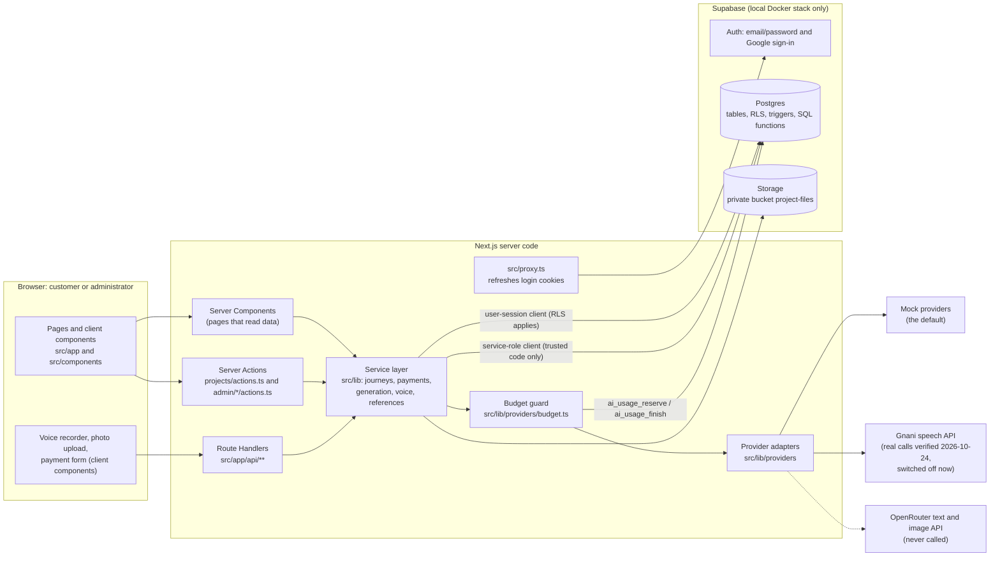
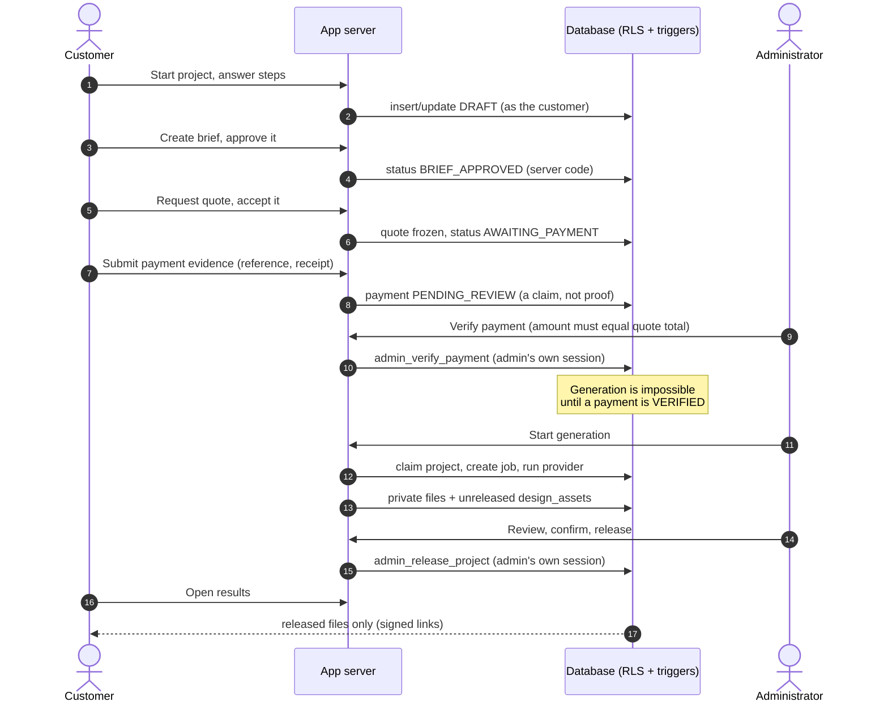
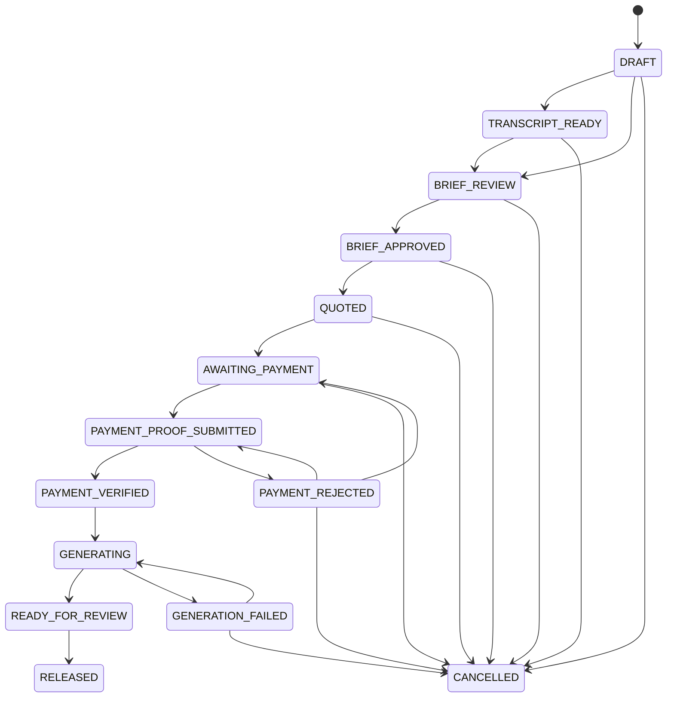

# ARCADIA Architectural Design — Prototype Technical Guide

> **Purpose.** A handover and presentation guide for the prototype in this repository. It tells you what exists, where the code is, how it works, what has actually been tested, and what is still mocked or unfinished.
>
> **Snapshot this guide describes** (taken 2026-10-24, read-only inspection):
>
> | Item | Value |
> |---|---|
> | Branch / HEAD | `main` at `ec18ac9` — "docs: document demo validation and release handoff" (24 commits in total) |
> | Working tree | 91 entries: 50 tracked files modified, 41 untracked entries, **nothing staged**. A large amount of work (the "real-integration pass") is **uncommitted**. |
> | Remote | `origin` = a **private** GitHub repository. The last known state (`git status -sb`) was in step with `origin/main`; that was not re-checked against GitHub for this guide, and the uncommitted work is **not** on GitHub. |
> | Local Supabase | 11 migrations applied to the **local** database (checked read-only on 2026-10-24); 11 public tables. **No hosted Supabase project exists.** |
> | Deployment | **None.** The app runs only on a developer machine. |
>
> **What this document is based on.** The source files, SQL migrations, tests, existing project documents and Git history in the repository, plus read-only queries against the local database. **No tests were run, no servers were started or stopped, no provider was called and no data was changed while writing it.** Where an earlier test run is mentioned, it is labelled as historical.
>
> **Secrets.** No key, token or password appears here. Environment variables are listed by **name** only.
>
> **Line numbers** are approximate positions in the working tree on the snapshot date and will drift. Always search by the function or symbol name shown beside them.

## How to read the status labels

| Label | Meaning |
|---|---|
| **Implemented and tested** | The code exists and automated tests and/or a recorded browser or local-stack run cover it. |
| **Implemented, verification incomplete** | The code exists but important parts have never been exercised for real (for example never run against the real service, or never in a browser). |
| **Mock/demo implementation** | It works, but produces clearly labelled placeholder output, not a real AI result. |
| **Partially implemented** | Some of the feature exists; a named part does not. |
| **Not implemented** | Nothing in the repository does this. |
| **Not verified** | A claim exists but the evidence needed to confirm it is missing. |

## Contents

- [A. Project overview](#a-project-overview)
- [B. Features and completion status](#b-features-and-completion-status)
- [C. Architecture and how the application works](#c-architecture-and-how-the-application-works)
- [D. "Where is the code?" file-location handbook](#d-where-is-the-code-file-location-handbook)
- [E. Supabase integration explained for a beginner](#e-supabase-integration-explained-for-a-beginner)
- [F. Important technical terms glossary](#f-important-technical-terms-glossary)
- [G. AI and voice integration status](#g-ai-and-voice-integration-status)
- [H. Security, privacy and safety safeguards](#h-security-privacy-and-safety-safeguards)
- [I. Tests and verification evidence](#i-tests-and-verification-evidence)
- [J. Documentation and configuration files created or maintained](#j-documentation-and-configuration-files-created-or-maintained)
- [K. Work completed and project history](#k-work-completed-and-project-history)
- [L. Mentor question preparation](#l-mentor-question-preparation)
- [M. Live file-navigation cheat sheet](#m-live-file-navigation-cheat-sheet)
- [N. Demo walkthrough](#n-demo-walkthrough)
- [O. Limitations and next steps](#o-limitations-and-next-steps)
- [P. Quick reference appendix](#p-quick-reference-appendix)

---

## A. Project overview

### A.1 What it is

ARCADIA Architectural Design is a **web prototype** (a Next.js application backed by Supabase) in which a customer describes something they want designed — a **new building on an empty plot**, an **interior refresh**, or a **garden/landscape** — and the system:

1. collects the requirements through guided, validated forms (typing, or optionally speaking);
2. turns the answers into a structured **English brief** that the customer reviews and approves;
3. calculates an **itemized quote** on the server from pricing rules;
4. lets the customer submit **evidence of an offline payment** (a reference number and an optional receipt image);
5. has an **administrator** check the money really arrived and explicitly **verify** (or reject) the payment;
6. only then lets an administrator **start design generation** (concept images, plus a drawn layout sketch for empty plots);
7. keeps the results **private** until the administrator reviews them and **releases** them;
8. then shows the released results to the owning customer only.

Everything it produces is a **concept**, not a construction drawing, CAD/BIM model or code-compliant plan. The app says so on screen.

### A.2 The problem it tries to solve

Design studios spend a lot of effort on the steps before any design work: gathering requirements, writing them up, quoting, and confirming payment. The prototype shows how those steps can be made structured and auditable, and how paid AI generation can be **gated** so it only runs after an administrator confirms payment — while keeping the customer's data private and the AI spending bounded.

### A.3 Who the users are

| Role | What they do | How the system knows who they are |
|---|---|---|
| **Customer** | Creates projects, answers questions, approves the brief, accepts the quote, submits payment evidence, views released results | Registers and signs in with email and password, or Google once configured (Supabase Auth). Owns rows via `projects.customer_id`. |
| **Administrator** | Reviews payment evidence, verifies/rejects payments, starts generation, reviews and releases results, publishes pricing rules | A row in `public.admin_users`, checked by the database function `public.is_admin()` on every request. Nothing the browser sends can grant it. |
| **The application server** | Next.js code that validates input, enforces rules, calls Supabase and providers | Runs server-side only. |
| **Supabase** | Stores users, data, files and enforces row-level rules | Local Docker stack only at present. |
| **AI/voice providers** | Gnani (speech-to-text, text-to-speech), OpenRouter (text brief, images) | Called only through adapters, behind a budget guard, and only when explicitly configured. |

### A.4 The main journey, step by step

1. **Choose a journey** on the landing page (`/`) → `/new/empty-plot`, `/new/interior`, `/new/landscape`.
2. **Sign in** (`/sign-in`): enter an email, click the link that arrives (in local development the mail lands in a local inbox).
3. **Start a project** → a `DRAFT` row is created in `projects`.
4. **Answer the steps** (`/projects/[id]/edit`): size, rooms, style, budget band, optional notes. Optionally record or upload a short WAV for the description (voice), or add reference photos (interior/landscape).
5. **Brief** (`/projects/[id]/brief`): the app builds an English brief; the customer edits, ticks a confirmation and approves (`BRIEF_APPROVED`).
6. **Quote** (`/projects/[id]/quote`): the server prices it from `pricing_rules`; the customer accepts the quote (it is then frozen).
7. **Payment evidence** (`/projects/[id]/payment`): the customer follows the displayed manual payment instructions, then submits a reference, date, amount and optional receipt image → status `PAYMENT_PROOF_SUBMITTED`. This is a **claim**, never proof.
8. **Administrator verification** (`/admin/payments`): checks the receiving account, enters the amount actually received (must equal the quote total) and verifies, or rejects with a reason.
9. **Generation** (`/admin/generation/[projectId]`): possible **only** after a verified payment (enforced in the database). Produces concept images (currently **mock placeholders**) and, for empty plots, a deterministic layout sketch.
10. **Review and release**: the administrator reviews, ticks confirmations and releases (`RELEASED`).
11. **Results** (`/projects/[id]/results`): the owning customer sees the released images; before release the page shows "nothing is available to view yet".

### A.5 What the prototype demonstrates — and what it does not

**Demonstrates (with evidence):** the full workflow above across three project types; server-side pricing; manual payment evidence with administrator verification; database-enforced gating of generation and release; private storage with owner/admin-only access; an append-only audit trail; a usage ledger and budget guard around every paid provider call; real Gnani speech-to-text and text-to-speech calls that succeeded in English and Tamil on 2026-10-24 (see section G).

**Does not (yet) demonstrate:** real AI-written briefs; real AI-generated design images; a hosted deployment; production security hardening; a verified mobile or accessible UI; Hindi voice; real payments (payments are manual by design).

### A.6 The 30-second explanation for a mentor

> "It's a web app where a customer describes a house, interior or garden, and gets a structured brief and an itemized quote. They submit proof of an offline payment, and an administrator verifies it. Only after that can design generation run, and the results stay private until the administrator releases them. Those rules are enforced in the database itself, not just in the interface, and every paid AI call goes through a usage ledger with a hard credit ceiling. It runs locally on Supabase. The brief and images are labelled mocks for now; the Gnani voice integration has been tested for real in English and Tamil."

---

## B. Features and completion status

The table is based on source files, tests and recorded runs. "Browser run" means a headless-Edge click-through of the real UI on the **local** stack. Test counts in the Evidence column are the number of test cases in the named file layer; see section I for what was last run.

| Feature | Implementation status | Evidence | Important file paths | Limitations |
|---|---|---|---|---|
| **Sign-in** (email and password, self-service registration, forgot/reset password, Google) and sign-out | Implemented; email/password, registration and reset **browser-verified 2026-10-28** against local Supabase Auth and Mailpit (17 checks); Google built but **not configured** | `tests/unit/auth-password.test.ts`, `tests/unit/auth-integration.test.ts` | `src/app/api/auth/*/route.ts`, `src/app/auth/callback/route.ts`, `src/app/(app)/sign-in/`, `src/app/(app)/reset-password/`, `src/lib/auth/`, `src/proxy.ts` | Local Supabase only; mail goes to a local inbox, not real email. Google needs an OAuth client (see `supabase/README.md`, "Sign-in methods"). |
| **Roles: customer vs administrator** | Implemented and tested | `tests/db/rls-isolation.test.ts`, `tests/db/schema.test.ts`; browser access-control checks | `supabase/migrations/20261017000100_helpers_and_admin.sql` (`public.admin_users`, `public.is_admin()`), `src/lib/auth/guards.ts`, `src/lib/admin/access.ts` | Admins are added by SQL; there is no admin-management screen. |
| **Customer projects** (3 types, multi-step forms, validation) | Implemented and tested | `tests/unit/journey-validation.test.ts`, `journey-service.test.ts`, `journey-actions.test.ts`; browser runs | `src/lib/journeys/service.ts`, `steps.ts`, `validation.ts`, `project-types.ts`; `src/app/(app)/projects/**`; `src/components/journey/step-form.tsx` | Mobile width and accessibility not checked. |
| **Brief creation** | **Mock/demo implementation** (default). OpenRouter writer: implemented, verification incomplete | `tests/unit/journey-brief.test.ts` (mock), `openrouter-brief.test.ts` (fake network) | `src/lib/journeys/brief.ts` (`mockBriefProvider`, `getBriefProvider`), `src/lib/providers/openrouter.ts` | The default writer is a fixed template, not AI. The OpenRouter adapter has **never been called for real**. |
| **Quotation and demo pricing** | Implemented and tested | `tests/unit/journey-quote.test.ts`; browser runs ("Demo rates" label) | `src/lib/journeys/quote.ts` (`computeQuote`), `src/lib/journeys/service.ts` (`createQuote`, `acceptQuote`), `supabase/demo/pricing_rules.demo.sql` | Rates are unverified demo numbers. No discounts. Real prices are an owner decision. |
| **Pricing administration** | Implemented, verification incomplete | `tests/unit/pricing-admin.test.ts`, `pricing-actions.test.ts`; browser run was view-only | `src/lib/pricing/admin.ts`, `src/app/(app)/admin/pricing/` | Publishing a price was never exercised against real Supabase RLS in a browser. |
| **Payment evidence submission** | Implemented and tested | `tests/unit/payment-service.test.ts`, `payment-evidence.test.ts`; `tests/live/payments-live.live.test.ts`; browser runs (no receipt file) | `src/lib/payments/service.ts` (`submitPayment`), `evidence.ts`, `src/app/api/payments/route.ts`, `src/components/payments/payment-form.tsx` | Receipt-image upload not browser-tested. Manual/offline only; no gateway (out of scope). |
| **Administrative payment verification / rejection** | Implemented and tested | `tests/db/workflow-guards.test.ts`; `tests/unit/payment-service.test.ts`; browser runs (verify path) | `src/lib/payments/service.ts` (`verifyPayment`, `rejectPayment`), SQL `admin_verify_payment`, `admin_reject_payment`, `src/app/(app)/admin/payments/` | Reject path not browser-tested. |
| **Generation restrictions / workflow gating** | Implemented and tested | `tests/db/workflow-guards.test.ts`, `tests/unit/generation-service.test.ts`, `tests/live/generation-live.live.test.ts` | SQL triggers `projects_guard`, `generation_jobs_guard`; `src/lib/generation/service.ts` (`startGeneration`) | — |
| **Concept image generation** | **Mock/demo implementation** (default). OpenRouter image adapter: implemented, verification incomplete | `tests/unit/image-provider.test.ts`, `generation-service.test.ts`; `openrouter-image.test.ts` (fake network) | `src/lib/providers/mock-image.ts`, `src/lib/providers/openrouter-image.ts`, `src/lib/generation/provider.ts` (`getImageProvider`) | Default images are placeholders stamped "MOCK — NOT A DESIGN". **No real image has ever been generated.** |
| **Empty-plot layout sketch (SVG)** | Implemented and tested | `tests/unit/floor-plan.test.ts`; browser run 2026-10-21 and 2026-10-24 | `src/lib/generation/floor-plan.ts`, `src/components/generation/floor-plan.tsx` | Drawn by code from the answers, not AI; illustrative only; empty plots only; not stored. |
| **Project release and customer access** | Implemented and tested | `tests/db/workflow-guards.test.ts`, `storage.test.ts`; `tests/live/generation-live.live.test.ts`; browser runs | `src/lib/generation/service.ts` (`releaseProject`), SQL `admin_release_project`, `src/lib/generation/read.ts` (`getCustomerResults`) | — |
| **Reference photo upload** | Implemented, verification incomplete | `tests/unit/reference-*.test.ts`, `tests/db/reference-uploads.test.ts`, `tests/live/references-storage.live.test.ts` | `src/lib/references/service.ts`, `src/app/api/projects/[id]/references/route.ts`, `src/components/journey/reference-uploads.tsx` | The repo docs say not browser-tested; a one-off browser upload check passed on 2026-10-24 in a development session (script kept outside the repository). Retention undecided. |
| **Speech-to-text (STT)** | Implemented; **real calls verified 2026-10-24 (English, Tamil)**; currently **disabled** | Local ledger rows (section G); `tests/unit/gnani-adapters.test.ts`, `voice-live-stt.test.ts`, `voice-route.test.ts`, `voice-service.test.ts` | `src/lib/providers/gnani.ts` (`createGnaniSttProvider`), `src/lib/voice/service.ts` (`transcribeForProject`), `src/app/api/projects/[id]/transcribe/route.ts` | Hindi unverified. Real microphone/Safari/phone not tested. Per-process rate limit only. |
| **Text-to-speech / spoken read-back** | Implemented; the **provider call** was verified for real (English and Tamil); the **read-back route and screen** were not exercised against the real service; currently **disabled** | Ledger rows; `tests/unit/readback.test.ts` (33 cases) | `src/lib/providers/gnani.ts` (`createGnaniTtsProvider`), `src/lib/voice/readback.ts` (`synthesizeReadback`), `src/app/api/projects/[id]/readback/route.ts`, `src/components/journey/readback-audio.tsx` | The in-app read-back is **English (`en-IN`) only** and speaks only the stored summary. |
| **Supported-language configuration** | Implemented and tested | `tests/unit/provider-config.test.ts`, `voice-mode.test.ts` | `src/lib/providers/config.ts` (`GNANI_STT_LANGUAGES`, `configuredGnaniLanguages`), `src/lib/journeys/voice.ts` | "Tanglish" is a demo-only label with no provider language code. |
| **Provider adapters + mock/demo modes** | Implemented and tested | `tests/unit/gnani-adapters.test.ts`, `openrouter-*.test.ts`, `image-provider.test.ts` | `src/lib/providers/*.ts`, `src/lib/journeys/voice.ts` (`getVoiceMode`) | Live OpenRouter modes unverified. |
| **Usage ledger, budgets, rate limits, consent** | Implemented and tested | `tests/db/ai-usage.test.ts`, `ai-usage-images.test.ts`, `tests/unit/provider-budget.test.ts`, `voice-rate-limit.test.ts`, `tests/live/ai-usage-live.live.test.ts` | `supabase/migrations/20261018000200_ai_usage.sql`, `src/lib/providers/budget.ts`, `src/lib/voice/rate-limit.ts` | Voice rate limit is per server process only. Consent is asked but not stored. |
| **Supabase database + private storage** | Implemented and tested (local) | `tests/db/*.test.ts` (in-process Postgres), `tests/live/*.live.test.ts` (local stack) | `supabase/migrations/*.sql`, `src/lib/supabase/*`, `src/lib/storage/paths.ts` | Local only. Hosted behaviour, hosted pooler and rollbacks on real PostgreSQL are unverified. |
| **Administrator screens** | Implemented and tested | Browser runs; `tests/unit/generation-*.test.ts`, `pricing-*.test.ts` | `src/app/(app)/admin/**`, `src/lib/generation/read.ts`, `src/components/payments/decision-forms.tsx` | No admin user management; no customer search. |
| **Audit trail** | Implemented and tested | `tests/db/happy-path.test.ts` ("records an audit trail") | SQL table `audit_events`, triggers in `…workflow_guards.sql` | Append-only; no UI to browse it. |
| **Status and health endpoints** | Implemented and tested | `tests/unit/integration-status.test.ts`, `health-route.test.ts` | `src/app/api/health/route.ts`, `src/lib/integrations/status.ts`, `src/app/(app)/status/page.tsx` | "Configured" never means "verified". |
| **Landing page with 3D massing preview** | Implemented, verification incomplete | Browser runs loaded the page; no dedicated test of the 3D scene | `src/app/(marketing)/page.tsx`, `src/components/landing/*`, `src/lib/landing/preview.ts` | Client-side demo only (three.js); deterministic, no AI, no server calls. |
| **Error handling and security controls** | Implemented and tested | See section H | Many | See section H. |
| **Hindi voice** | **Not verified** | Code accepts `hi-IN` as a documented code; no real request was ever made | `src/lib/providers/config.ts` (`GNANI_STT_LANGUAGES`) | Do not claim support. |
| **OpenRouter live (brief or images)** | **Not verified** | Adapters exist; zero OpenRouter rows in the ledger; `PROVIDER_MODE` unset | `src/lib/providers/openrouter.ts`, `openrouter-image.ts` | Needs a model choice, privacy decision, and (for images) spending approval. |
| **Hosted deployment** | **Not implemented** | No hosting config, no hosted Supabase project | — | Everything beyond local is open. |
| **Privacy notice / data retention** | **Not implemented** (a draft checklist exists) | `docs/PRIVACY_RETENTION_CHECKLIST.md` | — | No retention periods, no live-provider privacy notice. |
| **Automated payment gateway** | **Not implemented** (deliberately out of scope) | `CLAUDE.md` §3 | — | Manual payments only. |
| **Mobile layout and accessibility** | **Not verified** | README: "No mobile-width or accessibility check recorded" | — | — |

---

## C. Architecture and how the application works

### C.1 The stack in one paragraph

A **Next.js 16** application (App Router, React 19, TypeScript, Tailwind CSS 4) whose server code talks to **Supabase** (Postgres database, Auth, and private file Storage) through the official `@supabase/ssr` and `@supabase/supabase-js` libraries, and to AI providers through small **adapter** modules. Input is validated with **zod**. Tests use **Vitest**, with an in-process Postgres (**PGlite**) that applies the real migrations. The landing page has a small **three.js** preview. Versions are in `package.json`.

Next.js 16 changed some conventions (for example `src/proxy.ts` replaces the older "middleware" file, and the project enables Cache Components in `next.config.ts`), which is why `AGENTS.md` tells coding assistants to read `node_modules/next/dist/docs/` before writing Next.js code.

### C.2 Architecture diagram

This diagram shows only components and data flows that exist in the code. Dashed lines are paths that exist in code but are **not currently active** or have **never run for real**.



**In plain English.** The browser only ever talks to the Next.js server — there is **no Supabase client in the browser code** (the only `@supabase/ssr` users are `src/lib/supabase/server.ts` and `src/proxy.ts`). Pages, Server Actions and API routes call a **service layer** in `src/lib`. The service layer reads and writes Supabase using one of two clients: a **user-session client** (acts as the signed-in person, so the database's row-level security applies) or a **service-role client** (trusted code only, bypasses row-level security, never used for ordinary reads). Before any paid provider is called, the **budget guard** reserves the cost in a database ledger; if the reservation is refused, the provider is never contacted. Providers are reached only through **adapters**; with default settings the adapters are mocks.

### C.3 Customer workflow diagram



**In plain English.** Money and AI spending are guarded by checkpoints that are enforced **inside the database**, so a bug in the application code cannot skip them. A customer can only create a *claim*; only an administrator's own signed-in session can verify a payment or release results.

### C.4 Project status machine (derived from the migration)

These are the allowed status changes stored in the table `public.project_status_transitions` and enforced by the trigger `app_private.projects_guard` (`supabase/migrations/20261017000200_core_tables.sql` lines ~59–83).



Note: the application never sets `TRANSCRIPT_READY` (the voice step saves a transcript without changing status — see `docs/PROVIDERS.md`, "Storage" row); the status exists because the original specification defined it. `RELEASED` and `CANCELLED` are terminal.

### C.5 Frontend pages and components

All routes live under `src/app`. Folder names in parentheses (`(app)`, `(marketing)`) group routes without appearing in the URL.

| URL | File | Who | Purpose |
|---|---|---|---|
| `/` | `src/app/(marketing)/page.tsx` | anyone | Landing page: three journeys, 3D massing preview (`src/components/landing/*`) |
| `/new/[type]` | `src/app/(app)/new/[type]/page.tsx` | anyone to read; sign-in to start | Explains a journey, starts a draft (`startProjectAction`) |
| `/sign-in` | `src/app/(app)/sign-in/page.tsx` | anyone | Email form that calls `POST /api/auth/sign-in` |
| `/status` | `src/app/(app)/status/page.tsx` | anyone | Which optional services have settings present (names/states only) |
| `/projects` | `src/app/(app)/projects/page.tsx` | signed-in customer | "My projects" list |
| `/projects/[id]` | `…/projects/[id]/page.tsx` | owner | Project overview and progress |
| `/projects/[id]/edit` | `…/edit/page.tsx` | owner | Step-by-step requirement form (`src/components/journey/step-form.tsx`), voice (`voice-capture.tsx`), photos (`reference-uploads.tsx`) |
| `/projects/[id]/brief` | `…/brief/page.tsx` | owner | Create, edit and approve the brief; read-back summary |
| `/projects/[id]/quote` | `…/quote/page.tsx` | owner | Prepare and accept the quote |
| `/projects/[id]/payment` | `…/payment/page.tsx` | owner | Payment instructions and evidence form |
| `/projects/[id]/results` | `…/results/page.tsx` | owner | Released images and layout sketch |
| `/admin/payments` and `/admin/payments/[paymentId]` | `src/app/(app)/admin/payments/…` | administrator | Review queue, proof preview, verify/reject |
| `/admin/generation` and `/admin/generation/[projectId]` | `src/app/(app)/admin/generation/…` | administrator | Generation queue; start, review, release, recover |
| `/admin/pricing` | `src/app/(app)/admin/pricing/page.tsx` | administrator | View and publish pricing-rule versions |

Layouts: `src/app/layout.tsx` (root), `src/app/(app)/layout.tsx`, `src/app/(app)/projects/[id]/layout.tsx`. Reusable UI: `src/components/journey/*` (forms, progress, quote table, notices), `src/components/generation/*` (controls, gallery, floor-plan), `src/components/payments/*`, `src/components/pricing/rule-form.tsx`, `src/components/ui/status-badge.tsx`.

### C.6 Server-side routes and application logic

- **Server Actions** (`"use server"` files) are the main write path for customers and administrators. They validate their arguments, re-check who the caller is, and delegate to the service layer.
  `src/app/(app)/projects/actions.ts` (`startProjectAction`, `saveStepAction`, `createBriefAction`, `reviewBriefAction`, `createQuoteAction`, `acceptQuoteAction`, `removeReferenceAction`);
  `src/app/(app)/admin/generation/actions.ts` (`startGenerationAction`, `releaseProjectAction`, `clearStaleJobAction`, `removeLeftoverFilesAction`);
  `src/app/(app)/admin/payments/actions.ts` (`verifyPaymentAction`, `rejectPaymentAction`);
  `src/app/(app)/admin/pricing/actions.ts` (`publishPricingRuleAction`).
- **Route Handlers** (`src/app/api/**/route.ts`) are used where a request body is large or binary and the size must be checked **before** it is read: `api/payments` (receipt upload), `api/projects/[id]/transcribe` (WAV audio), `api/projects/[id]/readback` (text-to-speech), `api/projects/[id]/references` (photo upload), plus `api/auth/sign-in`, `api/auth/sign-up`, `api/auth/oauth`, `api/auth/forgot-password`, `api/auth/update-password`, `api/auth/sign-out`, `api/health`, and `src/app/auth/callback/route.ts` (finishes the magic-link sign-in).
- **Service layer** (`src/lib/*`) holds the business rules, so they can be unit-tested without a browser: `journeys/` (projects, steps, brief, quote), `payments/`, `generation/`, `voice/`, `references/`, `pricing/`, `providers/`.

### C.7 Authentication and authorization

- **Authentication** (who are you?) is Supabase Auth with **email and password** (`signInWithPassword`; a wrong email and a wrong password get the same answer), **self-service registration** (`signUp`), **password reset** (`resetPasswordForEmail`, then `/reset-password`) and **Google** (`signInWithOAuth`, once configured). Every redirect-based step returns to `/auth/callback` (PKCE code exchange, same browser). Cookies hold the session; `src/proxy.ts` refreshes them on every page and route.
- **Authorization** (what may you do?) is layered:
  1. **Page level:** `getPageAccess()` (`src/lib/journeys/access.ts`) → "not configured", "signed out", or "ok"; `getAdminAccess()` (`src/lib/admin/access.ts`) adds the admin check.
  2. **Code level:** `requireUser()` and `requireAdmin()` in `src/lib/auth/guards.ts`. `requireUser` calls `supabase.auth.getUser()` (which asks the Auth server) rather than trusting the cookie. `requireAdmin` additionally calls the database function `is_admin()`.
  3. **Ownership level:** e.g. `getOwnedProject()` (`src/lib/journeys/service.ts` ≈L59) returns the project only if `customer_id` equals the caller.
  4. **Database level:** row-level security policies, column grants, triggers and SQL functions (section E). This layer holds even if application code has a bug.
- **Origin check:** state-changing routes call `isAllowedOrigin()` (`src/lib/supabase/origin.ts`) and refuse requests from another origin (a defence against cross-site request forgery).

### C.8 Supabase client usage

Two server-side clients (details and "which to open" in sections D and E):

- `createSupabaseServerClient()` — `src/lib/supabase/server.ts`: anon key + the user's cookies → **acts as the user; RLS applies**.
- `createSupabaseServiceClient()` — `src/lib/supabase/service.ts`: service-role key, `import "server-only"` (importing it from browser code is a build error) → **bypasses RLS; trusted code only, after authentication/authorization**.

Both attach `createTimeoutFetch()` (`src/lib/supabase/timeout.ts`, 15 s normally, 60 s for files, never retried).

### C.9 Database access and migrations

SQL migrations in `supabase/migrations/` (11 files) create tables, constraints, indexes, triggers, functions, policies and the storage bucket. Each has a matching rollback in `supabase/rollbacks/`. Application code reads and writes through PostgREST (`supabase.from("projects")…`) and calls SQL functions through `supabase.rpc(…)`.

### C.10 Storage and uploads

One private bucket, `project-files`, holds three kinds of files under the path `<project_id>/<kind>/<file>`: `references/` (customer photos), `payment-proofs/` (receipts), `generated/` (design output). Paths are built and parsed by `src/lib/storage/paths.ts`. Uploads are limited to 5 MiB of JPEG/PNG/WebP at the bucket level (`20261018000100_payment_proof_limits.sql`); customer uploads through the app are further limited to 4 MiB so they fit Vercel's 4.5 MB request-body limit (`src/lib/uploads/limits.ts`), and the file type is also checked from the file's own bytes (`src/lib/payments/evidence.ts`, `src/lib/references/service.ts`). Customers receive only short-lived **signed links** (60 s for admin proof preview, 5 min for results and reference thumbnails).

### C.11 Provider adapters and external API boundaries

Interfaces in `src/lib/providers/interfaces.ts` (`SpeechToTextProvider`, `TextToSpeechProvider`, `ProviderError`); image interface in `images.ts`; brief interface in `src/lib/journeys/brief.ts` (`BriefProvider`). Implementations: Gnani (`gnani.ts`), OpenRouter text (`openrouter.ts`) and images (`openrouter-image.ts`), and mocks (`mock-speech.ts`, `mock-image.ts`, `mockBriefProvider` in `brief.ts`). Settings are read by `src/lib/providers/config.ts`, which **fails closed**: anything missing makes the provider "unavailable" and never silently falls back to a mock when a live mode was requested.

### C.12 Validation and security checks

Forms: `src/lib/journeys/validation.ts` with step definitions in `steps.ts`. Environment: `src/lib/env/schema.ts` (`parseEnv`). Money: `src/lib/journeys/money.ts` (integer minor units). Files: magic-byte checks. Audio: `src/lib/providers/wav.ts` (`parseWav`) measures the real duration from the bytes. AI output: `BriefDraftSchema` (strict zod) plus checks for invented numbers and forbidden claims in `src/lib/providers/openrouter.ts`; image output validated by `validateImageOutputs` in `src/lib/providers/images.ts`.

### C.13 Testing layers

| Layer | Location | Runs against |
|---|---|---|
| Unit | `tests/unit/` | Pure functions, fake Supabase (`tests/unit/support/fake-supabase.ts`), fake network (real network is blocked by `tests/unit/support/no-network.ts`) |
| Database | `tests/db/` | In-process Postgres (PGlite) with the **real migrations** applied |
| Live (local) | `tests/live/` | The real **local** Supabase stack; refuses non-local URLs |
| Provider smoke | `tests/provider-smoke/` | Real providers; opt-in only; skipped by default |
| Browser | not in the repository | Click-through scripts were run from outside the repo (see section I) |

---

## D. "Where is the code?" file-location handbook

**Git legend:** ✔ tracked and unchanged since the last commit · ✎ tracked **with uncommitted changes** · ＋ **untracked** (new, never committed) · 🔒 protected file (do not edit). Paths are relative to the repository root.

### D.0 If my mentor asks "Where is the Supabase integration code?"

Open these in this order and say the sentence beside each (all verified to exist):

| # | Open | Show | Say |
|---|---|---|---|
| 1 | `src/lib/supabase/config.ts` | `getSupabasePublicConfig`, `getServiceRoleKey` | "Settings come from environment variables. The URL and anon key are browser-safe; the service-role key is server-only." |
| 2 | `src/lib/supabase/server.ts` ✎ | `createSupabaseServerClient` | "This client acts as the signed-in user, so database security rules apply." |
| 3 | `src/lib/supabase/service.ts` ✎ | `createSupabaseServiceClient`, the `server-only` import | "This is the powerful client. It bypasses row-level security, so it's only used after I've checked who the caller is." |
| 4 | `src/proxy.ts` | `supabase.auth.getUser()` and cookie refresh | "This keeps the login session fresh." |
| 5 | `src/lib/auth/guards.ts` | `requireUser`, `requireAdmin` (calls `rpc("is_admin")`) | "Every protected action verifies the user with the Auth server and asks the database whether they're an admin." |
| 6 | `src/lib/journeys/service.ts` ✎ | `getOwnedProject` (≈L59), `createDraftProject` (≈L129) | "These are real queries: `supabase.from("projects")…`. Ownership is checked in code and again by the database." |
| 7 | `supabase/migrations/20261017000200_core_tables.sql` | `create table public.projects` … `payments` … `design_assets` | "This is the schema: tables, constraints, indexes." |
| 8 | `supabase/migrations/20261017000400_rls_and_grants.sql` | `enable row level security`, `create policy projects_select_own` | "Row-level security: a customer can only select rows where `customer_id` is theirs." |
| 9 | `supabase/migrations/20261017000300_workflow_guards.sql` | `projects_guard` (≈L83), `admin_verify_payment` (≈L686), `admin_release_project` (≈L749) | "Triggers and functions enforce the workflow inside the database." |
| 10 | `supabase/migrations/20261017000500_storage.sql` | bucket `project-files` (private), policies `project_files_select_own` (≈L82) | "Files are private; generated files are invisible to the customer until released." |
| 11 | `src/lib/payments/service.ts` | `submitPayment` (≈L110) uploading to Storage, `verifyPayment` (≈L290) calling the RPC | "Storage upload and the admin decision both go through Supabase." |
| 12 | `tests/db/rls-isolation.test.ts` and `tests/live/supabase-live.live.test.ts` | "A cannot read B" | "These prove one customer can't see another's data." |

### D.1 Application entry points and routing

| Path | Responsible for / key symbols | Open it when… |
|---|---|---|
| `src/app/layout.tsx` ✔ | Root layout (fonts, global CSS, header/footer) | Asked about the page shell |
| `src/app/(app)/layout.tsx` ✔ | Layout for app pages | — |
| `src/app/(marketing)/page.tsx` ✔ | The landing page `/` | Asked about the first screen |
| `src/proxy.ts` ✔ | `proxy` function, matcher `/sign-in`, `/auth/*`, `/api/auth/*` (Next 16's replacement for middleware); refreshes Supabase cookies, authorizes nothing | Asked how sessions stay alive |
| `next.config.ts` ✔ | `cacheComponents: true`, image formats, Turbopack CSS rule | Asked about framework settings |
| `src/app/error.tsx`, `global-error.tsx`, `not-found.tsx` ✔ | Error and 404 pages | Asked about error handling |

### D.2 Frontend pages and UI components

Routes: see C.5. Components:

| Path | Key exports | Open it when… |
|---|---|---|
| `src/components/journey/step-form.tsx` ✎ | The multi-step form; embeds voice capture and photo upload | Asked how requirements are collected |
| `src/components/journey/voice-capture.tsx` ✔ + `src/lib/voice/recorder.ts`, `capture.ts` | Consent box, microphone/WAV file, transcript box (`WavRecorder`, `VoiceCaptureController`) | Asked how recording works |
| `src/components/journey/readback-summary.tsx` ✎, `readback-audio.tsx` ＋ | Text read-back and the (consent-gated) "Listen" control | Asked about read-back |
| `src/components/journey/reference-uploads.tsx` ＋ | Photo upload and thumbnails | Asked about reference photos |
| `src/components/journey/quote-table.tsx`, `brief-review-form.tsx`, `progress.tsx`, `notice.tsx` ✔ | Quote table, brief editor, progress bar, notices | Asked about the customer screens |
| `src/components/generation/controls.tsx` ✎, `image-gallery.tsx`, `floor-plan.tsx` ✔ | Admin start/release/recover controls; gallery; sketch display | Asked about admin generation screens |
| `src/components/payments/payment-form.tsx`, `decision-forms.tsx` ✔ | Evidence form; admin verify/reject forms | Asked about the payment UI |
| `src/components/pricing/rule-form.tsx` ✎ | Pricing publish form | Asked about pricing admin |
| `src/components/landing/*` ✔ | `Hero`, `Configurator`, `MassingCanvas` (three.js), `massing.ts` | Asked about the landing animation |

### D.3 Customer project management

| Path | Key symbols | Open when / related |
|---|---|---|
| `src/lib/journeys/service.ts` ✎ | `getOwnedProject`, `listOwnProjects`, `createDraftProject`, `saveStep`, `createBrief`, `createQuote`, `acceptQuote` | Core customer logic. Related: `steps.ts`, `validation.ts`, `status.ts`, `access.ts` |
| `src/lib/journeys/project-types.ts` ✔ | `JOURNEYS`, `projectTypeFromSlug` | Asked about the three project types |
| `src/lib/journeys/steps.ts` ✔ | `JOURNEY_STEPS`, field definitions | Asked what questions are asked |
| `src/lib/journeys/validation.ts` ✔ | `validateStep`, `validateRequirements` | Asked about input validation |
| `src/lib/journeys/status.ts` ✔ | `STATUS_INFO`, `PROGRESS_STAGES` | Asked how status is shown to customers |
| `src/lib/db/schema.ts` ✔ | `PROJECT_STATUSES`, `PROJECT_STATUS_TRANSITIONS`, `canTransition` (TypeScript mirror of the DB rules) | Asked about statuses; `tests/unit/db-schema-constants.test.ts` keeps it in step with SQL |

### D.4 Architectural brief logic

| Path | Key symbols | Notes |
|---|---|---|
| `src/lib/journeys/brief.ts` ✎ | `BriefSchema`, `parseBrief`, `describeAnswers`, `buildBriefFacts`, `mockBriefProvider` (≈L306), `getBriefProvider` (≈L339) | The server composes facts; a provider supplies only the wording |
| `src/lib/providers/openrouter.ts` ✎ | `createOpenRouterBriefProvider` (≈L110), `BriefDraftSchema`, `BRIEF_SYSTEM_PROMPT`, `findInventedNumbers` | The live (unused) writer |
| `src/app/(app)/projects/[id]/brief/page.tsx` ✎, `src/components/journey/brief-review-form.tsx` ✔ | Brief page and editor | — |
| Tests | `tests/unit/journey-brief.test.ts` ✎, `openrouter-brief.test.ts` ✎ | — |

### D.5 Quotation and pricing

| Path | Key symbols | Notes |
|---|---|---|
| `src/lib/journeys/quote.ts` ✔ | `selectRules` (≈L89), `computeQuote` (≈L143), `isDemoVersion` | Pure calculation from `pricing_rules` |
| `src/lib/journeys/service.ts` ✎ | `createQuote` (≈L453), `acceptQuote` (≈L491) | Saves/freezes the quote |
| `src/lib/journeys/money.ts` ✔ | `toMinor`, `minorToDecimal`, `formatMoney` | Integer-based money |
| `src/lib/pricing/admin.ts` ✎ | `publishRuleVersion` (≈L81), `getPricingOverview` | Administrator price publishing |
| `supabase/demo/pricing_rules.demo.sql` ✔ | Demo rates, sets `pricing_mode` = demo | Loaded by hand; never for production |
| SQL | `public.pricing_rules`, `public.site_settings`, `public.quotes` in `…core_tables.sql` | Quote total formula is a database constraint |

### D.6 Payment evidence and verification

| Path | Key symbols |
|---|---|
| `src/lib/payments/service.ts` ✔ | `submitPayment` (≈L110), `listPaymentQueue`, `getPaymentForAdmin`, `createProofPreviewUrl` (≈L260), `verifyPayment` (≈L290), `rejectPayment` |
| `src/lib/payments/evidence.ts` ✔ | `checkEvidenceFile`, `sniffImage`, `parseAmountToMinor`, `EVIDENCE_MAX_BYTES` |
| `src/lib/payments/config.ts` ✔ | `getPaymentDisplay` (manual payment instructions from `PAYMENT_*` variables) |
| `src/app/api/payments/route.ts` ✔ | The upload endpoint (size checked before reading) |
| `src/app/(app)/admin/payments/` ✔ | Admin queue, detail page, `verifyPaymentAction`, `rejectPaymentAction` |
| SQL | `payments`, `app_private.payments_guard` (≈L307), `admin_verify_payment` (≈L686), `admin_reject_payment` (≈L716) in `…workflow_guards.sql` |
| Tests | `tests/unit/payment-service.test.ts`, `payment-evidence.test.ts`, `tests/live/payments-live.live.test.ts` ✎ |

### D.7 Image generation and layout sketches

| Path | Key symbols |
|---|---|
| `src/lib/generation/service.ts` ✎ | `startGeneration` (≈L128), `releaseProject` (≈L429), `isStaleJob`, `clearStaleJob` (≈L491), `removeLeftoverFiles` (≈L601), `isMockJob` |
| `src/lib/generation/prompt.ts` ✔ | `buildImageRequest` (≈L86), `viewsFor`, `IMAGE_PROMPT_VERSION` |
| `src/lib/generation/provider.ts` ✎ | `getImageProvider` — mock unless `PROVIDER_MODE=live` |
| `src/lib/generation/floor-plan.ts` ✔ | `planInputFromRequirements`, `layoutFloorPlan`, `renderFloorPlanSvg`, `describeFloorPlan` |
| `src/lib/generation/read.ts` ✔ | `describeGeneration`, `listGenerationQueue`, `getGenerationDetail`, `getCustomerResults` |
| `src/lib/providers/mock-image.ts` ✔, `images.ts` ✎ | `createMockImageProvider`; `validateImageOutputs`, size/type checks |
| `src/lib/providers/openrouter-image.ts` ＋ | `createOpenRouterImageProvider` (never run for real) |
| `src/lib/generation/references.ts` ＋ | `loadReferenceInputs` (reference photos for a live provider) |
| `src/app/(app)/admin/generation/` | Pages and `actions.ts` ✎ |
| SQL | `generation_jobs`, `design_assets`, `generation_jobs_guard` (≈L438), `design_assets_guard` (≈L518), `insert_generated_asset` (`20261022000300…`), `end_interrupted_generation` (`20261022000400…`) |

### D.8 Authentication and access control

`src/app/api/auth/sign-in/route.ts`, `src/app/auth/callback/route.ts`, `src/app/api/auth/sign-out/route.ts`, `src/proxy.ts`, `src/lib/auth/guards.ts` (`requireUser` ≈L8, `requireAdmin` ≈L20), `src/lib/auth/session.ts` (`getCurrentUser`), `src/lib/auth/errors.ts` (`AuthError`), `src/lib/admin/access.ts` (`getAdminAccess`), `src/lib/journeys/access.ts` (`getPageAccess`), `src/lib/supabase/origin.ts` (`isAllowedOrigin`). All ✔ tracked. SQL: `public.is_admin()` and `public.admin_users` in `20261017000100_helpers_and_admin.sql`. Tests: `tests/unit/auth-routes.test.ts`, `origin.test.ts`, `auth.test.ts`; `tests/db/rls-isolation.test.ts`.

### D.9 Supabase clients and configuration

`src/lib/supabase/config.ts` ✔ (`getSupabasePublicConfig`, `getServiceRoleKey`, `resolveAppOrigin`), `server.ts` ✎, `service.ts` ✎, `timeout.ts` ＋ (`createTimeoutFetch`), `origin.ts` ✔. Local stack settings: `supabase/config.toml` ✔ (ports 54321 API, 54322 database, 54324 mail inbox). Local-stack guide: `supabase/README.md` ✎.

### D.10 Database migrations, functions, tables, constraints and policies

| File | What it adds |
|---|---|
| `20261017000100_helpers_and_admin.sql` ✔ | schema `app_private`; `set_updated_at`; table `admin_users`; function `is_admin()` |
| `20261017000200_core_tables.sql` ✔ | tables `projects`, `project_status_transitions`, `quotes`, `payments`, `generation_jobs`, `design_assets`, `pricing_rules`, `site_settings`, `audit_events`; constraints; indexes |
| `20261017000300_workflow_guards.sql` ✔ | guard triggers; audit triggers; `admin_verify_payment`, `admin_reject_payment`, `admin_release_project` |
| `20261017000400_rls_and_grants.sql` ✔ | RLS enabled on 10 tables; privileges; 17 policies |
| `20261017000500_storage.sql` ✔ | private bucket `project-files`; path helper functions; 4 storage policies |
| `20261018000100_payment_proof_limits.sql` ✔ | bucket limit 5 MiB, JPEG/PNG/WebP only |
| `20261018000200_ai_usage.sql` ✔ | table `ai_usage`; `ai_usage_reserve`, `ai_usage_finish` |
| `20261021000100_restrict_transcript_columns.sql` ✔ | customers lose write access to transcript columns; guard trigger |
| `20261022000100_ai_usage_images.sql` ＋ | ledger accepts OpenRouter image metering (replaces `ai_usage_reserve`) |
| `20261022000300_insert_generated_asset.sql` ＋ | `insert_generated_asset()` — checked write path for generated files |
| `20261022000400_serialize_stale_clearing.sql` ＋ | `end_interrupted_generation()`; project-row locking in `generation_jobs_guard` |
| `supabase/rollbacks/*.down.sql` | One rollback per migration (first eight ✔; last three ＋) |
| `supabase/proposed/*` 🔒/＋ | **Not applied.** `20261020000100_release_only_succeeded_jobs.sql` 🔒 and its `.down.sql` 🔒 (protected); `20261022000200_assets_only_for_running_jobs.sql` ＋ and `.down.sql` ＋ (an unadopted proposal that conflicts with the protected test) |

### D.11 Supabase Storage integration and tests

`src/lib/storage/paths.ts` ✔ (`PROJECT_FILES_BUCKET`, `buildObjectPath`, `parseObjectPath`); upload code in `src/lib/payments/service.ts` (`submitPayment`), `src/lib/references/service.ts` ＋ (`addReference`), `src/lib/generation/service.ts` (generated files); SQL policies in `…storage.sql`. Tests: `tests/db/storage.test.ts`, `payment-proof-limits.test.ts`, `reference-uploads.test.ts` ＋, `tests/unit/storage-paths.test.ts`, `tests/live/references-storage.live.test.ts` ＋.

### D.12 AI provider integrations

`src/lib/providers/interfaces.ts` ✔, `config.ts` ✎, `budget.ts` ✎, `log.ts` ✎, `gnani.ts` ✎, `openrouter.ts` ✎, `openrouter-image.ts` ＋, `images.ts` ✎, `mock-image.ts` ✔, `mock-speech.ts` ✔, `wav.ts` ✔. Provider documentation: `docs/PROVIDERS.md` ✎.

### D.13 Gnani speech-to-text

| Path | Key symbols |
|---|---|
| `src/lib/providers/gnani.ts` ✎ | `createGnaniSttProvider` (≈L63); builds the multipart request to `{GNANI_BASE_URL}{GNANI_STT_ENDPOINT}` with header `X-API-Key-ID` |
| `src/lib/providers/config.ts` ✎ | `getGnaniSttReadiness` (≈L290), `GNANI_STT_LANGUAGES`, `GNANI_HARD_CEILING_CREDITS` (5,000) |
| `src/lib/journeys/voice.ts` ✎ | `getVoiceMode` (≈L73), `LIVE_STT_WIRED`, `getVoiceView` |
| `src/lib/voice/service.ts` ✎ | `transcribeForProject` (≈L85): owner, editable status, consent, language, WAV check, budget plan, ledger, provider |
| `src/app/api/projects/[id]/transcribe/route.ts` ✎ | The HTTP entry point: origin, size, auth, rate limit |
| `src/lib/voice/live.ts` ✎, `provenance.ts` ✔, `rate-limit.ts` ✎ | Live wiring; signed transcript tokens; per-user limits |
| `src/lib/providers/wav.ts` ✔ | `parseWav` |
| Browser side | `src/lib/voice/recorder.ts`, `capture.ts`, `wav-encode.ts`, `client.ts`; `src/components/journey/voice-capture.tsx` |
| Tests | `tests/unit/gnani-adapters.test.ts`, `voice-live-stt.test.ts` ＋, `voice-service.test.ts`, `voice-route.test.ts` ✎, `voice-mode.test.ts` ✎, `voice-provenance.test.ts`, `voice-wav.test.ts`, `voice-rate-limit.test.ts` |

### D.14 Gnani text-to-speech / read-back

`src/lib/providers/gnani.ts` ✎ (`createGnaniTtsProvider` ≈L115), `src/lib/providers/config.ts` ✎ (`getGnaniTtsReadiness` ≈L357, `READBACK_LANGUAGE = "en-IN"`, `GNANI_TTS_MODELS`), `src/lib/voice/readback.ts` ＋ (`synthesizeReadback` ≈L71, `fitForSpeech`, `looksLikeAudio`), `src/app/api/projects/[id]/readback/route.ts` ＋, `src/components/journey/readback-audio.tsx` ＋, `src/components/journey/readback-summary.tsx` ✎. Tests: `tests/unit/readback.test.ts` ＋, `gnani-adapters.test.ts`.

### D.15 OpenRouter integration (live or mock?)

**Mock by default; the live adapters exist but have never been called.** `src/lib/providers/openrouter.ts` ✎ (text/brief: `POST {base}/chat/completions`, strict JSON schema), `openrouter-image.ts` ＋ (images: `POST {base}/images`), settings in `config.ts` (`getOpenRouterConfig` ≈L65, `getOpenRouterImageConfig` ≈L116), selection in `brief.ts` (`getBriefProvider`) and `generation/provider.ts` (`getImageProvider`). Live only when `PROVIDER_MODE=live` **and** the key and model variables are set. Tests: `openrouter-brief.test.ts` ✎, `openrouter-image.test.ts` ＋, `openrouter-smoke-guard.test.ts` ＋ (all fake network). Opt-in smoke harness: `tests/provider-smoke/` ＋ and `vitest.smoke.config.mts` ＋.

### D.16 Usage ledger, budget controls and provider safeguards

`src/lib/providers/budget.ts` ✎ (`reserveUsage` ≈L42, `finishUsage`, `withUsage` ≈L111, `planGnaniCall` ≈L211, `planOpenRouterBrief`, `planOpenRouterImages`, `refusalMessage`); SQL `ai_usage`, `ai_usage_reserve`, `ai_usage_finish` (`20261018000200_ai_usage.sql`, replaced by `20261022000100_ai_usage_images.sql`); `src/lib/voice/rate-limit.ts` ✎ (`TRANSCRIBE_LIMITS`, `READBACK_LIMITS`); `src/lib/references/limiter.ts` ＋; `src/lib/providers/config.ts` (caps and timeouts). Tests: `tests/db/ai-usage.test.ts`, `ai-usage-images.test.ts` ＋, `tests/unit/provider-budget.test.ts`, `voice-rate-limit.test.ts`, `tests/live/ai-usage-live.live.test.ts`.

### D.17 API routes and server actions

See C.6 for the full list with symbols. Folders: `src/app/api/**` and the four `actions.ts` files.

### D.18 Validation, schemas and shared types

`src/lib/env/schema.ts` ✎ (`envSchema`, `parseEnv`, `isSet`), `src/lib/journeys/validation.ts`, `steps.ts`, `brief.ts` (`BriefSchema`), `src/lib/db/schema.ts` (status/enum constants), `src/lib/payments/evidence.ts`, `src/lib/providers/wav.ts`, `src/lib/providers/images.ts`, `src/lib/storage/paths.ts`.

### D.19 Tests

`tests/unit/` (48 files), `tests/db/` (18 files, including 🔒 `release-invariant.test.ts`), `tests/live/` (8 files, `*.live.test.ts`), `tests/provider-smoke/` (2 files). Shared helpers: `tests/unit/support/` (`fake-supabase.ts`, `journey-fixtures.ts`, `no-network.ts`), `tests/db/support/`.

### D.20 Build, lint, typecheck and test configuration

`package.json` ✎ (scripts), `tsconfig.json`, `eslint.config.mjs`, `next.config.ts`, `vitest.config.mts` (unit + db; network blocked), `vitest.live.config.mts` (local Supabase only), `vitest.smoke.config.mts` ＋ (real providers; opt-in), `.gitattributes`. All ✔ unless marked.

### D.21 Environment variable documentation

`.env.example` ✎ (blank template with comments), `architectural-ai-design-spec/ENVIRONMENT_VARIABLES.md`, `src/lib/env/schema.ts` (the validation), `README.md` ✎ ("Environment checklist", "Configuration"), `docs/PROVIDERS.md` ✎. The real values live in `.env.local`, which is **git-ignored** (`.gitignore`: `.env*` except `.env.example`) and is never shown here.

### D.22 Main README, demo, provider, Supabase and other docs

`README.md` ✎, `docs/DEMO_SCRIPT.md` ✎, `docs/PROVIDERS.md` ✎, `supabase/README.md` ✎, `docs/REAL_INTEGRATION_COMPLETION_REPORT.md` ＋, `docs/IMPLEMENTATION_REQUIREMENTS_AUDIT.md` ＋, `docs/PRIVACY_RETENTION_CHECKLIST.md` ＋, `handoff.md` 🔒＋ (untracked, protected), and the specification pack `architectural-ai-design-spec/` ✔ (`00_PROJECT_OVERVIEW.md` … `13_ARCHITECTURE_DECISION.md`) and phase prompts `architectural-ai-skill-integrated-prompts/` ✔.

### D.23 Git and repository configuration

`.gitignore` ✔, `.gitattributes` ✔, remote `origin` (private GitHub repository), branch `main`, 24 commits. `skills-lock.json` ✔ (skill integration lock).

### D.24 Local AI coding instructions

| File | Git | Notes |
|---|---|---|
| `CLAUDE.md` (root) | ✎ tracked, modified | The **active** instruction file for the coding assistant (section J.2) |
| `architectural-ai-design-spec/CLAUDE.md` | removed in the final release (kept in Git history) | Was "source guidance"; the root `CLAUDE.md` governs |
| `AGENTS.md` (root) | ✔ tracked | One block telling assistants Next.js 16 differs from training data — read `node_modules/next/dist/docs/` first. Written by `next dev` |
| `.claude/settings.json` | ignored (`.gitignore`) | Local assistant settings (top-level key: `hooks`); not inspected further |
| `.claude/settings.local.json` | ignored — by the user's **global** Git ignore file (`~/.config/git/ignore`, rule `**/.claude/settings.local.json`), not by this repository's `.gitignore` | Local overrides (contents not read). Another clone of the repository would not have it ignored by default. |
| `.claude/skills/design-taste-frontend/` | no longer tracked; kept locally and git-ignored (licence not confirmed) | The one approved design skill (see `skills-lock.json`) |
| `.claude/skills/<13 other folders>` | ignored by `.gitignore` | Unplanned skills kept local-only |
| `graphify-out/` | ignored | Generated knowledge graph output |

### D.25 Sequences to open for common questions

| Topic | Open in this order |
|---|---|
| **Authentication** | `src/app/(app)/sign-in/page.tsx` → `src/app/api/auth/sign-in/route.ts` (`signInWithPassword`; also `sign-up`, `oauth`, `forgot-password`, `update-password`) → `src/app/auth/callback/route.ts` → `src/proxy.ts` → `src/lib/auth/guards.ts` → `tests/unit/auth-routes.test.ts` |
| **Brief creation** | `src/lib/journeys/steps.ts` → `src/lib/journeys/brief.ts` (`buildBriefFacts`, `mockBriefProvider`) → `src/lib/journeys/service.ts` (`createBrief` ≈L297) → `src/app/(app)/projects/[id]/brief/page.tsx` → `tests/unit/journey-brief.test.ts` |
| **Quote and payment** | `src/lib/journeys/quote.ts` (`computeQuote`) → `src/lib/journeys/service.ts` (`acceptQuote`) → `src/lib/payments/service.ts` (`submitPayment`, `verifyPayment`) → SQL `payments_guard` and `admin_verify_payment` → `tests/db/workflow-guards.test.ts` |
| **Image generation** | `src/lib/generation/service.ts` (`startGeneration`) → `src/lib/generation/provider.ts` → `src/lib/providers/mock-image.ts` → SQL `generation_jobs_guard` / `insert_generated_asset` → `src/lib/generation/floor-plan.ts` → `tests/unit/generation-service.test.ts` |
| **Gnani STT/TTS** | `src/lib/providers/config.ts` (`getGnaniSttReadiness`) → `src/lib/providers/gnani.ts` → `src/lib/voice/service.ts` / `src/lib/voice/readback.ts` → `src/app/api/projects/[id]/transcribe/route.ts` → `tests/unit/gnani-adapters.test.ts` |
| **Usage and budget safeguards** | `src/lib/providers/budget.ts` (`planGnaniCall`, `withUsage`) → `supabase/migrations/20261018000200_ai_usage.sql` (`ai_usage_reserve`) → `src/lib/voice/rate-limit.ts` → `tests/db/ai-usage.test.ts` |
| **Tests proving the flows** | `tests/db/happy-path.test.ts` → `rls-isolation.test.ts` → `workflow-guards.test.ts` → `storage.test.ts` → `tests/unit/generation-service.test.ts` → `tests/live/generation-live.live.test.ts` |

---

## E. Supabase integration explained for a beginner

### E.1 What Supabase does in this prototype

Supabase is a ready-made **backend**: a Postgres **database**, a user **sign-in** service (Auth), and **file storage**, all behind one web API. This project uses all three:

| Supabase part | Used for | Where in the code |
|---|---|---|
| **Auth** | Email/password and Google sign-in; "who is this user?" | `src/app/api/auth/sign-in/route.ts`, `src/lib/auth/guards.ts`, `src/proxy.ts` |
| **Postgres database** | All application data (projects, quotes, payments, jobs, assets, prices, audit trail, usage ledger) and the **rules** that protect it | `supabase/migrations/*.sql`, queries in `src/lib/**/service.ts` |
| **Storage** | Private files: reference photos, payment receipts, generated images | `src/lib/storage/paths.ts`, upload code in `src/lib/payments/service.ts`, `src/lib/references/service.ts`, `src/lib/generation/service.ts` |

Today it runs as a **local stack in Docker** on the developer machine (API on port 54321, database on 54322, local mail inbox on 54324; `supabase/config.toml`). **No hosted Supabase project exists.**

### E.2 How the application connects

Three environment variables (names only): `NEXT_PUBLIC_SUPABASE_URL`, `NEXT_PUBLIC_SUPABASE_ANON_KEY` (both safe to expose to a browser by design) and `SUPABASE_SERVICE_ROLE_KEY` (**secret, server-only**). They are read in `src/lib/supabase/config.ts`. If they are missing, the app shows a "not configured" state instead of crashing.

### E.3 Browser client or server client?

**Only server clients exist.** A repository search finds `@supabase/ssr` only in `src/lib/supabase/server.ts` and `src/proxy.ts`. The browser never holds a Supabase client; it calls Next.js pages, Server Actions and API routes, and those use:

1. **The user-session client** (`createSupabaseServerClient`): anon key plus the user's cookies. Because the request is "as the user", **the database's Row Level Security decides what is visible**.
2. **The service-role client** (`createSupabaseServiceClient`): the powerful key. It skips Row Level Security. Used for things customers must not do directly — writing a quote, moving a project's status, writing generated files, writing the usage ledger — and only after the code has verified the caller.

### E.4 How authentication is handled

1. Customer creates an account or signs in on `/sign-in` → `POST /api/auth/sign-up` or `/api/auth/sign-in` → Supabase Auth sets the session cookies. A wrong email and a wrong password both get "Email or password is incorrect.", and the reset form always answers the same way, so neither can be used to discover which emails have accounts.
2. The link goes to `/auth/callback` which sets the session cookies.
3. `src/proxy.ts` refreshes the cookies on auth routes.
4. Each protected request calls `supabase.auth.getUser()` (asks the Auth server — never just trusts a cookie) inside `requireUser()`.
5. Administrator status is **not** a login claim. `requireAdmin()` asks the database: `rpc("is_admin")`, which looks the user up in `public.admin_users`. A revoked admin loses access immediately.

### E.5 How data is stored and retrieved

Reads and writes use the Supabase JavaScript library, for example `supabase.from("projects").select("*").eq("id", projectId)` in `getOwnedProject` (`src/lib/journeys/service.ts` ≈L59), which then also checks `project.customer_id === userId`. Multi-step rules use database functions through `supabase.rpc(...)`, for example `admin_verify_payment` (`src/lib/payments/service.ts` `verifyPayment`), `admin_release_project` (`releaseProject`), `insert_generated_asset` (`startGeneration`) and `ai_usage_reserve` (`src/lib/providers/budget.ts`).

### E.6 The tables (real schema, 11 tables in `public`)

| Table | Purpose | Important columns | Relationships |
|---|---|---|---|
| `projects` | One customer request | `customer_id`, `project_type` (`EMPTY_PLOT`/`INTERIOR`/`LANDSCAPE`), `status` (14 values), `requirements_json`, `english_brief_json`, `english_brief_text`, `approved_at`, transcript columns | `customer_id` → `auth.users` |
| `project_status_transitions` | The allowed status moves (24 rows) | `from_status`, `to_status` | Read by the guard trigger; no end-user access |
| `quotes` | Server-calculated quotes | `line_items_json`, `subtotal`, `tax_amount`, `total_amount`, `pricing_rule_version`, `accepted_at` | `project_id` → `projects`. Constraints: total = subtotal + tax − discount; **at most one accepted quote per project** |
| `payments` | A customer's payment **claim** and the admin decision | `amount_claimed`, `method`, `utr_reference`, `proof_storage_path`, `status` (`PENDING_REVIEW`/`VERIFIED`/`REJECTED`), `verified_by`, `confirmed_amount`, `audit_note` | `project_id` → `projects`, `quote_id` → `quotes`, `verified_by` → `auth.users`. **At most one pending payment per project**; a decision always names the admin and time |
| `generation_jobs` | One provider run for a project | `status` (`QUEUED`/`RUNNING`/`SUCCEEDED`/`FAILED`), `provider`, `image_model`, `idempotency_key`, `usage_json`, `error_code` | `project_id` → `projects`. **At most one active job per project**; unique idempotency key per project. Customers cannot read this table |
| `design_assets` | Files: references, payment proofs, generated outputs | `asset_type`, `storage_path` (unique), `is_released`, `generation_job_id` | `project_id` → `projects`, `generation_job_id` → `generation_jobs`. Constraints tie the path to the project and type; only generated types can be released |
| `pricing_rules` | Versioned prices (admin-managed) | `project_type`, `rule_key`, `rate`, `unit`, `version`, `effective_from/until` | Unique per (type, key, version) |
| `site_settings` | Admin settings such as `pricing_mode` | `key`, `value_json`, `version` | — |
| `audit_events` | Append-only history of sensitive actions | `actor_id`, `action`, `project_id`, `payment_id`, `metadata_json` | No foreign key on `actor_id` on purpose (history must outlive a deleted user). Updates, deletes and truncation are blocked by triggers |
| `admin_users` | Who is an administrator | `user_id` | → `auth.users` |
| `ai_usage` | Ledger of every AI provider call | `customer_id`, `provider`, `operation`, `unit`, `units_estimated`, `units_reported`, `status` (`RESERVED`/`SUCCEEDED`/`FAILED`/`NOT_SENT`), `request_id` | `customer_id` → `auth.users`, `project_id` → `projects`. Never stores prompts, transcripts, audio or keys |

Outside `public`: Supabase's own `auth.users` (accounts), `storage.buckets` and `storage.objects` (files), and the bucket `project-files`.

### E.7 Migrations — what each one changes

See the table in D.10. In one line each: 1 = admin role source; 2 = tables and constraints; 3 = rules (guards, audit, admin functions); 4 = row-level security and privileges; 5 = private storage; 6 = upload limits; 7 = usage ledger; 8 (`20261021…`) = customers can no longer write transcript columns; 9 (`20261022000100`) = ledger can meter images; 10 (`20261022000300`) = checked write path for generated files; 11 (`20261022000400`) = project-row locking so clearing a stale job cannot clash with a new one.

### E.8 Row Level Security, grants, constraints and functions (what actually protects the data)

1. **RLS is on for every public table** (`20261017000400_rls_and_grants.sql` lines 18–27; `ai_usage` enables it in its own migration). With RLS on, a row is visible only if a **policy** allows it.
2. **Privileges start at zero.** The migration first `revoke all … from anon, authenticated`, then grants only what is needed (so there are two independent layers: privileges and policies). The anonymous role receives nothing.
3. **Customer policies** (examples): `projects_select_own` (`customer_id = auth.uid()`), `projects_insert_own` (must be a `DRAFT`), `projects_update_own_draft` (only while editable), `payments_insert_own_pending`, `design_assets_select_own` (generated files only once released).
4. **Column-level grants** hide sensitive columns: customers cannot read `payments.verified_by` or `audit_note`, cannot update `status`, and (since migration 8) cannot write the transcript columns.
5. **Administrator policies** (`projects_select_admin`, `payments_select_admin`, `generation_jobs_select_admin`, `audit_events_select_admin`, `pricing_rules_admin_all`, `site_settings_admin_all`) all call `public.is_admin()`.
6. **Guard triggers** (`…workflow_guards.sql`) enforce the invariants **even for the service role**: legal status transitions only; generation requires a verified payment; release requires an administrator, a verified payment and generated assets; accepted quotes are frozen; payment decisions are final; the confirmed amount must equal the quote total; audit rows can't be changed.
7. **Administrator functions** `admin_verify_payment`, `admin_reject_payment`, `admin_release_project` are `SECURITY DEFINER`, check `is_admin()` first, and are the **only** way to decide or release.
8. **Server-only functions** (`ai_usage_reserve`, `ai_usage_finish`, `insert_generated_asset`, `end_interrupted_generation`) have `revoke all … from public, anon, authenticated` followed by `grant execute … to service_role` (see the end of `20261018000200_ai_usage.sql`, `20261022000100_ai_usage_images.sql`, `20261022000300_insert_generated_asset.sql`, `20261022000400_serialize_stale_clearing.sql`); internal helpers live in the non-exposed schema `app_private`.

### E.9 Storage rules

Bucket `project-files` is **private** (no public URL; only signed links created by server code). Policies on `storage.objects` (`20261017000500_storage.sql`):
- `project_files_insert_own`: a customer may upload `references/` files to their own editable project, and `payment-proofs/` files only while payment is due; paths must be exactly `<project_id>/<kind>/<file>`.
- `project_files_select_own`: owners read their own references and receipts; **generated files only after `design_assets.is_released`**.
- `project_files_select_admin`: administrators can preview everything.
- `project_files_delete_own_reference`: customers can delete their own references while editable.
- **No policy lets any customer write the `generated/` folder** — only the service role can.
Bucket limits: 5 MiB, JPEG/PNG/WebP (`…payment_proof_limits.sql`).

### E.10 How one customer is stopped from reaching another's project

Four independent layers: (1) the page needs a signed-in user (`getPageAccess`); (2) the service code checks `project.customer_id === userId` (`getOwnedProject`); (3) the user-session client means **RLS filters rows to the caller's own** (`projects_select_own`); (4) storage policies match the path's `project_id` to the caller's project. A stranger asking for someone else's project gets "not found". The browser runs on 2026-10-21 and 2026-10-24 confirmed this for projects and for results before and after release.

### E.11 How the database integration is tested

- `tests/db/*.test.ts` start an **in-process Postgres (PGlite)**, apply the **real migrations**, then act as different roles. Examples: `rls-isolation.test.ts` ("A cannot read B"), `workflow-guards.test.ts` (illegal transitions rejected), `storage.test.ts` (generated files hidden until release), `schema.test.ts` (every table has RLS; anon has nothing), `rollback.test.ts`.
- `tests/live/*.live.test.ts` run against the **real local Supabase stack** (refuse non-local URLs), e.g. `tests/live/supabase-live.live.test.ts`, `tests/live/payments-live.live.test.ts`, `tests/live/generation-live.live.test.ts`, `ai-usage-live.live.test.ts`.
- Not verified: anything on a hosted Supabase project.

### E.12 Plain-English terms

| Term | Meaning | In this project |
|---|---|---|
| **Backend** | The part of an app that runs on a server, not in the browser | Next.js server code in `src/lib`, `src/app/api`, Server Actions — plus Supabase |
| **Database** | Organized, permanent storage of records in tables | Postgres inside Supabase; the 11 tables above |
| **Supabase client** | A code object that sends requests to Supabase | `createSupabaseServerClient`, `createSupabaseServiceClient` |
| **Authentication vs authorization** | "Who are you?" vs "What may you do?" | Authentication: email/password or Google + `getUser()`. Authorization: `requireAdmin`, ownership checks, RLS |
| **SQL migration** | A numbered script that changes the database structure | `supabase/migrations/2026…sql` (11), each with a rollback |
| **Row Level Security (RLS)** | The database filters rows per user | `enable row level security` + policies |
| **Database policy** | A rule saying who may select/insert/update/delete which rows | `create policy projects_select_own …` |
| **Database function / RPC** | A stored procedure the app can call by name | `supabase.rpc("admin_verify_payment", …)` |
| **Foreign key** | A column that must point to a real row in another table | `payments.project_id → projects.id` |
| **Constraint** | A rule the database refuses to break | `quotes_total_formula`, "one pending payment per project" |
| **Supabase Storage** | File storage with its own access policies | Bucket `project-files`, private |
| **Service role key** | A master key that bypasses RLS | Server-only; leaking it would expose every customer's data, so it must never reach a browser, log or repository |
| **Local vs hosted Supabase** | The same software on your PC in Docker vs on Supabase's cloud | Only local exists here; hosted behaviour is unverified |

---

## F. Important technical terms glossary

| Term | Simple definition | How it applies here (example / file) |
|---|---|---|
| **Frontend / backend** | What runs in the browser / what runs on a server | Frontend: `src/components`, `src/app/**/page.tsx` client parts. Backend: `src/lib`, route handlers, Supabase |
| **API / API route** | A defined way for programs to talk; an HTTP endpoint | `src/app/api/projects/[id]/transcribe/route.ts` = `POST /api/projects/{id}/transcribe` |
| **Server Action** | A function the browser can call that runs on the server | `startGenerationAction` in `src/app/(app)/admin/generation/actions.ts` |
| **REST API** | HTTP requests (GET/POST…) on URLs returning data | Gnani's `/stt/v3` and OpenRouter's `/chat/completions` are called this way |
| **JSON** | A text format for structured data | `requirements_json` column; provider request/response bodies |
| **Environment variable / `.env.local`** | A setting kept outside the code; the file holding local values | `.env.local` is git-ignored; template is `.env.example` |
| **Git, branch, commit** | Version control; a line of history; a saved snapshot | Branch `main`, 24 commits, HEAD `ec18ac9` |
| **Working tree / untracked file** | The files on disk now; files Git has never saved | 91 entries: 50 modified, 41 untracked |
| **TypeScript / typechecking** | JavaScript with types; the compiler checking them | `npm run typecheck` (`tsc --noEmit`) |
| **ESLint** | A tool that flags code problems | `npm run lint` |
| **Unit / integration / end-to-end / browser / live test** | Small-part tests / parts together / whole flow / flow in a real browser / against a real service | `tests/unit`, `tests/db`, (browser scripts outside repo), `tests/live` |
| **Mock vs real provider** | A fake stand-in vs the actual external service | `mock-image.ts` vs `openrouter-image.ts` |
| **Provider adapter** | A small module hiding a service's details behind a common interface | `src/lib/providers/gnani.ts` |
| **STT / TTS** | Speech→text / text→speech | Gnani "Prisma" (STT) and "Timbre" (TTS) |
| **Session** | The signed-in state, kept in cookies | Supabase Auth cookies refreshed by `src/proxy.ts` |
| **Consent** | The customer's explicit agreement before data goes to a provider | Required by `transcribeForProject` and `synthesizeReadback`; not stored |
| **Rate limiting** | Capping how often something can happen | `src/lib/voice/rate-limit.ts` (10 recordings/min, 5 read-backs/min per user) |
| **Usage ledger / reservation / budget cap** | A table logging provider calls; claiming the cost before the call; a total spending ceiling | `ai_usage`, `ai_usage_reserve`, 5,000-credit Gnani ceiling |
| **Production build vs development server** | The optimized, stable build vs the live-reloading developer server | `npm run build` + `next start` vs `npm run dev` |
| **Feature flag** | A setting that turns a feature on or off | `GNANI_VOICE_ENABLED`, `PROVIDER_MODE` |
| **HTTP status code** | A number summarizing a response | 200 ok; 401 not signed in; 403 forbidden; 404 not found; 429 too many requests; 503 unavailable |
| **Signed URL** | A temporary link granting access to one private file | 60 s admin proof preview, 5 min results (`createSignedUrl` in the service files) |
| **Idempotency key** | A token making a repeated request safe | `generation_jobs.idempotency_key` — same key never runs the provider twice |
| **Provenance token** | A tamper-proof stamp showing text really came from the speech service | `src/lib/voice/provenance.ts` (HMAC-SHA256, 30-minute life) |
| **Fail closed** | If unsure, refuse | Missing Gnani rate → no call (`getGnaniSttReadiness`) |
| **Credit** | Gnani's billing unit | 1 credit = ₹1 per the owner's dashboard (not in the repo) |
| **WAV / PCM** | Uncompressed audio file / raw samples | The app accepts only mono 16-bit WAV (`src/lib/providers/wav.ts`) |
| **PGlite** | A Postgres that runs inside the test process | `tests/db/` |
| **PKCE code exchange** | The browser that started a Google sign-in or an emailed link proves it is the same one when the code comes back | `exchangeCodeForSession` |
| **Mermaid** | Text-based diagrams | Used in this guide |

---

## G. AI and voice integration status

### G.1 Status at a glance

| Component | Code exists | Default behaviour now | Real request verified? | Currently enabled? |
|---|---|---|---|---|
| Brief writer — mock | Yes (`mockBriefProvider`) | **Used** (`PROVIDER_MODE` unset) | n/a | Yes |
| Brief writer — OpenRouter | Yes (`openrouter.ts`) | Not used | **No** (0 OpenRouter ledger rows) | No |
| Image generator — mock | Yes (`mock-image.ts`) | **Used** | n/a | Yes |
| Image generator — OpenRouter | Yes (`openrouter-image.ts`) | Not used; reports "unavailable" if live mode is set without an image model | **No** | No |
| Layout sketch (SVG) | Yes (`floor-plan.ts`) | **Used** (empty plots) — code, not AI | n/a | Yes |
| Gnani speech-to-text | Yes (`gnani.ts`) | Off | **Yes — English and Tamil, 2026-10-24** | **No** (`GNANI_VOICE_ENABLED=false`) |
| Gnani text-to-speech | Yes (`gnani.ts`, `readback.ts`) | Off | **Provider call: yes — English and Tamil.** In-app read-back route/screen: no | **No** |
| Mock voice | Yes (`mock-speech.ts`) | Off unless `GNANI_VOICE_ENABLED=mock` | n/a | No |
| Hindi | Code accepts `hi-IN` | — | **No** | — |

### G.2 What is real AI and what is a mock in the current configuration?

- **Brief:** a **template** composed by code (`mockBriefProvider`, `src/lib/journeys/brief.ts`). The UI labels it "Demo/mock output". It is **not** an AI-written brief.
- **Concept images:** deterministic **placeholder PNGs** stamped "MOCK — NOT A DESIGN" (`src/lib/providers/mock-image.ts`). The job record says `provider = mock`. Releasing mock images requires an explicit extra confirmation (`releaseProject`, `acknowledgeMock`).
- **Layout sketch:** drawn by code from the customer's numbers (`floor-plan.ts`); deterministic, not AI, not CAD, not stored.
- **Voice:** off. With `GNANI_VOICE_ENABLED=mock` the transcript is a fixed placeholder that cannot be saved as a description.

### G.3 Gnani (speech) in detail

**Host and authentication.** Only `https://api.vachana.ai` is allowed (`GNANI_ALLOWED_HOSTS` in `src/lib/providers/config.ts`; any other host makes voice "unavailable"). The API key goes in the header `X-API-Key-ID`. This matches Gnani's public documentation (docs.gnani.ai) as read on 2026-10-24.

**Speech-to-text** — `createGnaniSttProvider` (`src/lib/providers/gnani.ts` ≈L63):
- URL = `GNANI_BASE_URL` + `GNANI_STT_ENDPOINT` (documented: `/stt/v3`).
- Request: multipart form with `audio_file` (the WAV) and `language_code` (e.g. `ta-IN`); optional `X-API-Request-ID` if a UUID.
- Response must be JSON `{ success: true, transcript, request_id? }` (validated by zod); transcripts over 5,000 characters are rejected.
- One request, **no retry**; timeout from `PROVIDER_TIMEOUT_MS` (default 30 s).
- Audio handling: the app accepts **WAV only** — mono, 16-bit PCM, 8–48 kHz, 0.5–30 s — and measures the real duration from the bytes (`parseWav`, `src/lib/providers/wav.ts`); the browser's claimed type/length is ignored. Recording happens in the browser (`src/lib/voice/recorder.ts`), which encodes 16 kHz mono WAV.
- No audio is stored; the transcript is returned to the browser only, with a signed provenance token.

**Text-to-speech** — `createGnaniTtsProvider` (≈L115):
- URL = `GNANI_BASE_URL` + `GNANI_TTS_ENDPOINT` (documented: `/api/v1/tts/inference`).
- JSON body: `text`, `model` (`timbre-v2.5` or `timbre-v3.0`), `voice`, `language`, `speed: 1.0`, `audio_config` (24 kHz, mono, 16-bit, WAV).
- The answer must be audio (`Content-Type` starting `audio/`), non-empty and ≤ 8 MiB; the read-back code additionally checks the bytes look like real audio (`looksLikeAudio`).
- In the app the read-back is **English only** (`READBACK_LANGUAGE = "en-IN"`), speaks only the **server-stored summary** (the browser sends no text), shortened to `GNANI_TTS_MAX_CHARS` (default 600).

**Language configuration.** `GNANI_LANGUAGES` is filtered to the codes Gnani documents for STT: `bn-IN, en-IN, gu-IN, hi-IN, kn-IN, ml-IN, mr-IN, pa-IN, ta-IN, te-IN`. The local configuration offers `ta-IN` and `en-IN`. "Tanglish" is a demo-only label with no provider code. Documented voices: for `timbre-v2.5` the Tamil voices are Asmita, Trisha, Brinda, Vedika, Noopur and the English ones include Kaveri; `timbre-v3.0` voices are not interchangeable with v2.5 voices.

**Credit safeguards** (all fail-closed): rates `GNANI_CREDITS_PER_STT_SECOND` / `GNANI_CREDITS_PER_TTS_CHAR` (owner-supplied; Gnani publishes none), `GNANI_MAX_CREDITS_PER_REQUEST`, `GNANI_CUSTOMER_CREDITS_PER_HOUR`, `GNANI_BUDGET_CREDITS` (clamped to the 5,000 ceiling, also in SQL). Estimates round up to 0.01 credit; one Gnani call in flight app-wide; every call is reserved in `ai_usage` first. Details in section H.

**Safe-by-default switch.** `getVoiceMode` (`src/lib/journeys/voice.ts` ≈L73): empty or `false` → off; `mock` → labelled mock; `true` → live only if every setting is present, otherwise "unavailable" (never silently the mock); any other value → "invalid" (unavailable). *The `false` → off rule is an uncommitted change made on 2026-10-24; before it, `false` was treated as invalid.*

**Tests (all fake network; counts are `it(...)` blocks, and `it.each` expands them at run time):** `tests/unit/gnani-adapters.test.ts` (13 cases), `voice-live-stt.test.ts` (18), `readback.test.ts` (33), `voice-service.test.ts`, `voice-route.test.ts`, `voice-mode.test.ts`, `provider-config.test.ts` (15), `provider-budget.test.ts` (17).

### G.4 Evidence that real Gnani requests succeeded

This evidence is **not yet recorded in the repository's own documents** (`README.md`, `CLAUDE.md`, `docs/PROVIDERS.md` and `handoff.md` still say no real Gnani call has been made — see the drift note in section J). What exists is:

1. **The local usage ledger** (`public.ai_usage`, read-only query on 2026-10-24) holds exactly four Gnani rows, all `SUCCEEDED`:

   | Time (database clock, UTC; IST is +5:30) | Operation | Model | Ledger estimate |
   |---|---|---|---|
   | 2026-10-24 12:16 (≈17:46 IST) | STT (English) | — | 0.12 credits |
   | 2026-10-24 12:16 (≈17:46 IST) | TTS (English) | `timbre-v2.5` | 0.41 |
   | 2026-10-24 12:34 (≈18:04 IST) | TTS (Tamil) | `timbre-v2.5` | 0.55 |
   | 2026-10-24 12:34 (≈18:04 IST) | STT (Tamil) | — | 0.12 |
   | | **Total** | | **1.20 credits (estimate)** |

   The ledger holds estimates at 4× the owner's dashboard rates; it is **not** the provider's invoice. Gnani returns no usage figure. As of the snapshot the real dashboard balance had **not** been checked.
2. **What each test showed** (from the development session): English STT of a locally generated 3.4 s speech clip returned the text "a house with two bedrooms and a garden"; English TTS (voice Kaveri, 37 characters) returned a valid 1.92 s WAV; Tamil TTS (voice Asmita, 50 characters) returned a valid 3.36 s WAV; Tamil STT of that audio returned the sentence exactly (ignoring punctuation).
3. **How they were run, honestly:** the STT calls went through the app's real route (`POST /api/projects/[id]/transcribe`) as a signed-in, consenting local customer. The TTS calls went through the same readiness check, budget plan and ledger (`withUsage`) with the existing adapter, from a scratch test harness, because the in-app read-back route cannot send a short custom sentence. The Tamil speech-to-text input was the Tamil TTS output (this PC has no Tamil voice), with only the WAV header size fields rewritten locally because Gnani's header declares unknown sizes. Scripts live in a temporary scratch folder, not in the repository.
4. **Limits of this evidence:** one call each; synthetic speech, not a human speaker; no real microphone; the in-app read-back screen was not run against the real service; Hindi was not tested; the actual charge is unverified.

**Voice is currently disabled** (`GNANI_VOICE_ENABLED=false`, last set 2026-10-24); the local setup is otherwise complete, so enabling it is one switch plus a restart.

### G.5 OpenRouter

- **Text/brief adapter:** `createOpenRouterBriefProvider` (`src/lib/providers/openrouter.ts` ≈L110) → `POST {OPENROUTER_BASE_URL}/chat/completions` with `Authorization: Bearer <key>`, a strict `json_schema` response format and `provider.require_parameters: true`; one request, no retry; the model supplies only the wording, the server composes the rest; output is rejected if it adds numbers not in the customer's data or claims "construction-ready" etc.
- **Image adapter:** `createOpenRouterImageProvider` (`openrouter-image.ts` ＋) → `POST {base}/images` (one image per view, sequential, one retry only for 429/502/503, never after a timeout); output validated by `validateImageOutputs`.
- **Configuration required** (names): `PROVIDER_MODE=live`, `OPENROUTER_API_KEY`, `OPENROUTER_TEXT_MODEL` (text), `OPENROUTER_IMAGE_MODEL` (images), optional tuning (`OPENROUTER_IMAGE_RESOLUTION`, `…_ASPECT_RATIO`, `…_FORMAT`, `…_TIMEOUT_MS`; no usage quota: the old `AI_BRIEFS_PER_HOUR` and `OPENROUTER_DAILY_REQUEST_CAP` are no longer read). Host is locked to `openrouter.ai`.
- **Current state:** `PROVIDER_MODE` is unset (mock). A key variable is present locally but unused; no text or image model is configured; the ledger has **zero** OpenRouter rows. Both adapters are tested only with a fake network. Note that `PROVIDER_MODE=live` is *global*: with no image model set, admin "start generation" reports unavailable (it never falls back to the mock).
- **Context from the development session (not a repository fact):** on 2026-10-24 OpenRouter's public model catalogue listed free text models with structured-output support and no free image-output models.

### G.6 What requires credentials/configuration, and what stays disabled

| Capability | Needs | State |
|---|---|---|
| Live speech-to-text | `GNANI_VOICE_ENABLED=true`, key, base URL, endpoint, languages, credit rate, caps, budget, `VOICE_TRANSCRIPT_SECRET` | All present locally; switch is **off** |
| Live read-back | The above plus `GNANI_TTS_MODEL`, `GNANI_TTS_VOICE`, `GNANI_CREDITS_PER_TTS_CHAR`, `en-IN` in `GNANI_LANGUAGES` | Present; switch **off** |
| Live brief | `PROVIDER_MODE=live`, key, text model | Model missing; **disabled** |
| Live images | `PROVIDER_MODE=live`, key, image model, spending approval, migration 9 applied | Model missing; **disabled** |
| Hindi | A real test on the owner's Gnani account | **Not verified** |

---

## H. Security, privacy and safety safeguards

**Legend:** *Implemented* = the code exists. *Tested* = an automated test covers it (path given). Nothing here means the prototype is production-ready.

| # | Safeguard | Implementation | Test evidence | Status |
|---|---|---|---|---|
| 1 | Signed-in check on protected actions | `requireUser` (`src/lib/auth/guards.ts`), `getPageAccess` | `tests/unit/auth-routes.test.ts`, voice/payment route tests ("refuses a caller who is not signed in") | Implemented, tested |
| 2 | Administrator authorization from the database | `requireAdmin` → `rpc("is_admin")`; SQL `admin_*` functions check it again | `tests/db/workflow-guards.test.ts`; browser: customer on `/admin/*` → "no access" | Implemented, tested |
| 3 | Cross-customer isolation | RLS policies + `getOwnedProject` + storage policies | `tests/db/rls-isolation.test.ts`, `storage.test.ts`, `tests/live/supabase-live.live.test.ts`; browser runs | Implemented, tested (local) |
| 4 | Customers cannot change status/approval/decisions | `projects_guard` trigger; column grants | `tests/db/workflow-guards.test.ts`, `schema.test.ts` | Implemented, tested |
| 5 | Payment is a claim; only an admin decides; amount must equal quote | `payments_guard`, `admin_verify_payment`; `verifyPayment` | `tests/db/workflow-guards.test.ts`, `tests/unit/payment-service.test.ts` | Implemented, tested |
| 6 | Generation impossible before verified payment | `generation_jobs_guard`, `projects_guard` (→ `GENERATING` needs a verified payment) | `tests/db/workflow-guards.test.ts`, `tests/unit/generation-service.test.ts`, live generation suite | Implemented, tested |
| 7 | Duplicate/concurrent generation blocked | Unique index "one active job per project"; `idempotency_key`; project claim by conditional update | `tests/unit/generation-service.test.ts`, `tests/live/generation-live.live.test.ts` | Implemented, tested |
| 8 | Results hidden until released | `project_files_select_own` + `design_assets_select_own`; `getCustomerResults` reads nothing before `RELEASED`; `admin_release_project` is admin-only | `tests/db/storage.test.ts`, browser runs | Implemented, tested |
| 9 | Release refuses leftovers from failed attempts; mock needs acknowledgement | `releaseProject` pre-checks | `tests/unit/generation-service.test.ts`, `generation-recovery.test.ts` ＋ | Implemented, tested. *A database-level version of this rule is proposed (`supabase/proposed/`) but **not adopted**.* |
| 10 | Stale-job late-write race closed for the app's write path | `insert_generated_asset`, `end_interrupted_generation` | `tests/db/insert-generated-asset.test.ts` ＋, `serialize-stale-clearing.test.ts` ＋, live counterparts ＋ | Implemented, tested (local). *A DB-wide rule for direct service-role inserts is **not** adopted.* |
| 11 | Append-only audit trail | `audit_events` triggers | `tests/db/happy-path.test.ts` | Implemented, tested (no UI to browse it) |
| 12 | Input validation | `src/lib/journeys/validation.ts`, `steps.ts`, zod in routes | `tests/unit/journey-validation.test.ts` | Implemented, tested |
| 13 | File validation (type from bytes, size, count) | `src/lib/payments/evidence.ts`, `src/lib/references/service.ts`; bucket limits | `tests/unit/payment-evidence.test.ts`, `reference-*.test.ts` ＋, `tests/db/payment-proof-limits.test.ts` | Implemented, tested |
| 14 | Cross-site request protection | `isAllowedOrigin` on state-changing routes | `tests/unit/origin.test.ts` | Implemented, tested |
| 15 | Secrets stay server-side | `import "server-only"` in the service client; `.env*` git-ignored; env validated by `parseEnv`; logs carry names/status only (`src/lib/providers/log.ts`) | `tests/unit/env-schema.test.ts`; `voice-mode.test.ts` ("never returns or names a value"); `provider-config.test.ts` | Implemented, tested |
| 16 | Provider host allow-lists, https only | `GNANI_ALLOWED_HOSTS`, `OPENROUTER_HOST` | `tests/unit/provider-config.test.ts` | Implemented, tested |
| 17 | Provider and database timeouts | `AbortSignal.timeout` in adapters; `createTimeoutFetch` | `tests/unit/gnani-adapters.test.ts`, `tests/unit/supabase-timeout.test.ts` ＋ | Implemented, tested |
| 18 | No automatic retries on paid calls | Gnani `send()` single attempt; OpenRouter text single attempt; images retry once only for unbilled statuses | adapter tests | Implemented, tested |
| 19 | Reservation **before** every paid call, fail closed | `withUsage`/`reserveUsage` (`budget.ts`); SQL `ai_usage_reserve` (advisory lock, 3 s lock timeout, NaN/zero/negative refused) | `tests/db/ai-usage.test.ts`, `tests/unit/provider-budget.test.ts`, `tests/live/ai-usage-live.live.test.ts` | Implemented, tested |
| 20 | Per-request cap, per-customer hourly limit, cumulative ceiling (5,000, also clamped in SQL), one Gnani call in flight | `planGnaniCall`, `ai_usage_reserve` | same as 19 | Implemented, tested |
| 21 | Per-user request rate limits for voice | `src/lib/voice/rate-limit.ts` (10 recordings/min, 5 read-backs/min, one at a time) | `tests/unit/voice-rate-limit.test.ts` | Implemented, tested. **Per server process only** (memory; resets on restart; not shared across instances) |
| 22 | Consent before audio/text leaves for Gnani | `transcribeForProject`, `synthesizeReadback` refuse without consent | `voice-service.test.ts`, `readback.test.ts` | Implemented, tested. Consent is **not stored** |
| 23 | Audio never stored; transcripts tamper-evident | Audio lives only in request memory; `provenance.ts` HMAC token; transcript columns writable only by the server (migration 8) | `voice-provenance.test.ts`, `tests/db/transcript-columns.test.ts`, `voice-persistence.test.ts` | Implemented, tested |
| 24 | Mock output can't masquerade as the customer's words or as a design | Mock transcript label guard (`containsMockTranscript`); `MOCK — NOT A DESIGN` stamp; release acknowledgement | `voice-mode.test.ts`, `voice-route.test.ts` (label guard); `generation-service.test.ts` (mock acknowledgement) | Implemented, tested. *Known gap: deleting only the label could leave placeholder text (documented in `docs/PROVIDERS.md`).* |
| 25 | AI output treated as untrusted | `BriefDraftSchema` (strict), invented-number and forbidden-claim checks; `validateImageOutputs`; `parseWav` | `openrouter-brief.test.ts`, `image-provider.test.ts`, `voice-wav.test.ts` | Implemented, tested (fake network) |
| 26 | Safe error messages | `AuthError` codes, generic messages, `error.tsx` | route tests | Implemented; no stack traces to customers (spot-checked in route code, not exhaustively audited) |
| 27 | Short-lived file links | `createSignedUrl` with 60 s / 300 s lifetimes | service tests | Implemented, tested |

### H.1 Controls that are incomplete, unverified or open

- Everything above was verified on the **local** stack and in-process Postgres only. No hosted environment, no penetration test, no dependency-vulnerability audit and no security-header/CSP review was done or found.
- The voice rate limit is per process; a multi-instance deployment needs shared storage.
- Consent is asked each time but not recorded; no privacy notice or retention periods exist (`docs/PRIVACY_RETENTION_CHECKLIST.md` is a draft).
- Two database-level proposals are **not adopted**: releasing only succeeded jobs (`supabase/proposed/20261020000100_…`, protected) and refusing asset inserts for non-running jobs (`20261022000200_…`); they conflict with the protected `tests/db/release-invariant.test.ts`.
- The service-role client bypasses RLS; safety depends on every call site checking the caller first (the code comments and tests enforce this by convention, not by a compiler).
- Rollbacks have not been rehearsed on a real PostgreSQL server.
- Browser verification is partial (no mobile width, accessibility, real microphone, Safari).

---

## I. Tests and verification evidence

**Important distinction.** *No test, build, server or provider call was run while writing this guide.* The "last known result" column quotes earlier reports (named in the column) or earlier development sessions. Treat them as history, not as a fresh result.

| Category | Command / method | What it verifies | Key test paths | Last known result (source) | Needs services or credentials? | Run during this documentation task? |
|---|---|---|---|---|---|---|
| **Typecheck** | `npm run typecheck` (`tsc --noEmit`) | Types across the whole project | — | Clean (`CLAUDE.md` §19; also re-run clean in a development session on 2026-10-24 after the voice-switch change) | No | No |
| **Lint** | `npm run lint` (`eslint`) | Code-style/safety rules | — | Clean (same sources; the 2026-10-24 run covered only the four changed files) | No | No |
| **Unit + in-process database tests** | `npm test` (`vitest run`; config `vitest.config.mts`; real network **blocked** by `tests/unit/support/no-network.ts`) | Business rules, adapters (fake network), and the **real migrations** inside PGlite: RLS, guards, storage rules, rollbacks | `tests/unit/*.test.ts` (48 files), `tests/db/*.test.ts` (18 files) = 66 files | `CLAUDE.md` §19 reports **66 files / 1,460 tests passed** (run of 2026-10-22). Older, differing figures exist: README 52 files / 1,126 tests (2026-10-21); `docs/REAL_INTEGRATION_COMPLETION_REPORT.md` 64 files / 1,427 tests (2026-10-22) | No | No |
| **Focused voice/config tests** | `npx vitest run tests/unit/voice-mode.test.ts tests/unit/integration-status.test.ts tests/unit/voice-route.test.ts tests/unit/voice-service.test.ts tests/unit/voice-components.test.ts tests/unit/voice-live-stt.test.ts tests/unit/provider-config.test.ts tests/unit/readback.test.ts` | The "`false` means off" change and voice/provider config | listed | 8 files / 226 tests passed in a development session on 2026-10-24 (not recorded in a repo document) | No | No |
| **Production build** | `npm run build` | The app compiles and prerenders | — | Passed per `CLAUDE.md`/the completion report (2026-10-22); rebuilt successfully again in a development session on 2026-10-24 | No | No |
| **Live local Supabase suites** | `LIVE_SUPABASE=1 npx vitest run --config vitest.live.config.mts` (refuses non-local URLs) | The same rules on the **real local stack** incl. real storage and concurrency | `tests/live/*.live.test.ts` (8 files) | Per `CLAUDE.md` §19 (2026-10-22): generation-live 24, payments-live 21, supabase-live 43 (+1 skipped), ai-usage-live 16, references-storage 11, insert-generated-asset 9, serialize-stale-clearing 6 passed. `late-asset-writes` (4) **temporarily applies an unadopted proposal** — do not run casually | Local Supabase in Docker; `.env.local` with local keys | No |
| **Provider smoke harness** | `LIVE_PROVIDER_SMOKE=1 npm run smoke:providers` (config `vitest.smoke.config.mts`) | One bounded real call per configured provider | `tests/provider-smoke/providers.smoke.test.ts` ＋ | Skipped all four tests on 2026-10-22 (no credentials then). The real Gnani calls of 2026-10-24 did **not** use this harness | **Yes — real credentials, spends credits** | No |
| **Browser journeys** | Playwright-core driving headless Edge against the running app (scripts kept **outside** the repository, in a temporary folder) | The real UI end to end: sign-in, create, brief, quote, payment, admin verify, mock generation, release, results, isolation | not in repo | 2026-10-21: three journeys, dev server (`README.md`). 2026-10-22: 36 PASS / 1 CHECK / 0 FAIL on the production build (completion report). 2026-10-24 (development session): 55 of 56 passed on the **development** server (the one failure was an undersized test image, later re-checked successfully), 11 of 11 sign-in/isolation checks on the development server, and 26 of 26 on a trimmed rerun against the **production build** | Running app + local Supabase; local mail inbox | No |
| **Protected invariant test** | part of `npm test` | A leftover asset on a failed job is currently publishable (documents the gap the proposal would close) | `tests/db/release-invariant.test.ts` 🔒＋ | Counted in the 66-file figure above | No | No |

**Why the test counts differ.** Vitest expands `it.each(...)` into several cases, and the documents were written at different moments; the exact current number can only be obtained by running `npm test`.

### Commands a developer can run later (none executed for this guide)

```bash
npm run typecheck
npm run lint
npm test                                   # unit + in-process DB; add --exclude tests/db/release-invariant.test.ts for the committed tree only
NEXT_TELEMETRY_DISABLED=1 npm run build
# Needs Docker + local Supabase running and .env.local pointing at it:
LIVE_SUPABASE=1 npx vitest run --config vitest.live.config.mts
# Real providers, spends credits, needs explicit approval and credentials:
LIVE_PROVIDER_SMOKE=1 npm run smoke:providers
```

---

## J. Documentation and configuration files created or maintained

### J.1 The files, their purpose and Git status

"Created" means the commit that first added the file, from `git log --diff-filter=A`. "Modified" means uncommitted changes exist now. Authorship: all 24 commits are by one Git user, "Viyajith Samrat"; who wrote text inside a commit (the developer or an AI assistant) is **not recorded** in Git and is not claimed here.

| File | Purpose | Audience | Git status | Created in | Contains |
|---|---|---|---|---|---|
| `README.md` | Status, what works, limitations, environment checklist, runbook, configuration, project layout | Human developers | ✎ tracked, modified | `8c491e0` (2026-10-16) | Setup, test guidance, safety rules, demo pointer |
| `CLAUDE.md` | Operating rules and current state for the coding assistant | **AI coding assistant** (also readable by humans) | ✎ tracked, modified | `af52604` (2026-10-16) | Scope, security invariants, workflow gates, section 19 "current state and standing rules" |
| `AGENTS.md` | Warning that Next.js 16 differs from older versions; read `node_modules/next/dist/docs/` | AI coding assistants | ✔ tracked | `8c491e0` | One auto-generated block (written by `next dev`) |
| `docs/PROVIDERS.md` | What was verified about OpenRouter and Gnani, budget rules, voice design, image design | Developers | ✎ | `c731275` (2026-10-20) | Provider configuration guidance, safety rules |
| `docs/DEMO_SCRIPT.md` | Timed five-minute demo with fallbacks | Presenter | ✎ | `ec18ac9` (2026-10-21) | Demo steps |
| `supabase/README.md` | Schema map, invariants, local setup commands, decisions, review findings | Developers | ✎ | `b3e87a6` (2026-10-17) | Supabase setup and test notes (the README itself says it is partly out of date) |
| `.env.example` | Blank template of every setting, with explanations | Developers | ✎ | `8c491e0` | Configuration names (no values) |
| `.gitignore` | Keeps secrets and generated folders out of Git: `.env*` (except `.env.example`), `.next/`, `node_modules/`, `.claude/settings.json`, 13 unplanned skill folders, `graphify-out/` | Developers | ✔ | `8c491e0` | Safety rule for secrets |
| `package.json` | Scripts and dependencies | Developers | ✎ (adds `smoke:providers`) | `8c491e0` | Test/build scripts |
| `docs/REAL_INTEGRATION_COMPLETION_REPORT.md` | Per-issue root cause/fix/test, provider statuses, owner actions | Developers/owner | ＋ untracked | not yet committed | Test guidance, provider status |
| `docs/IMPLEMENTATION_REQUIREMENTS_AUDIT.md` | PR-001…PR-035 status matrix | Developers/owner | ＋ | not yet committed | Requirement evidence |
| `docs/PRIVACY_RETENTION_CHECKLIST.md` | Draft of what is stored where and decisions needed | Owner | ＋ | not yet committed | Privacy/retention gaps |
| `handoff.md` 🔒 | Detailed session-by-session handoff (section 0.P is newest) | Developer / assistant | ＋ untracked, **protected** | not yet committed | Exact state, commands, gotchas |
| `architectural-ai-design-spec/*.md` | The original specification pack (PRD, TRD, app flow, UI/UX, schema, plan, risks, demo, decisions) | Humans and assistant | ✔ | `8c491e0` | Source of truth for requirements |
| `architectural-ai-skill-integrated-prompts/*.md` | Phase prompts used to drive the build in order | Assistant | ✔ | (baseline) | Phase workflow |

### J.2 What the root `CLAUDE.md` tells the assistant to do

It is the **active** instruction file (the copy under `architectural-ai-design-spec/` is "source guidance"; the root file wins). In short:

- **Read first, plan second, implement only when authorized, verify every phase**; stop at phase boundaries and wait for approval.
- **Source of truth:** the specification pack and original PDF; do not silently change requirements.
- **Scope:** a prototype for design ideation, not a professional production system; no automated payment gateway; nothing described as construction-ready, CAD/BIM or code-compliant.
- **23 security and integrity invariants** (section 7): never authorize generation from client state; payment evidence is a claim; only a server-side workflow after an authorized administrator action marks payment verified; generated assets private until released; secrets never in `NEXT_PUBLIC_*`, logs or commits; model output is untrusted; critical transitions are audited.
- **Environment rules:** blank `.env.example`; real values only in git-ignored `.env.local`; never print secret values; no invented endpoints or model IDs.
- **Working rules:** do not commit, push, apply migrations to any hosted project, create hosted resources or spend money without approval; report only checks actually run.
- **Section 19** is a running status log (what is done, what is unverified, protected paths, standing rules).
It is meant for the **AI assistant**; humans use `README.md`.

### J.3 Local, ignored and tracked instruction/config files

- **Tracked:** `CLAUDE.md`, `AGENTS.md` and `skills-lock.json`. The design skill `.claude/skills/design-taste-frontend/` is kept locally but no longer tracked (git-ignored), and the spec folder's copy of `CLAUDE.md` was removed.
- **Ignored by the repository:** `.claude/settings.json` (a local assistant configuration; its top-level key is `hooks`; contents not reproduced here), `.env.local`, 13 unplanned skill folders, `graphify-out/`, `.next/`, `node_modules/`.
- **Ignored by the user's global Git rules, not the repository's:** `.claude/settings.local.json`.
- **Untracked but not ignored:** `handoff.md` and the files listed in D (＋).
- **Only the root `CLAUDE.md` and `AGENTS.md` instruct the assistant inside the repository**; no `CLAUDE.local.md` or other `AGENTS.md` exists in the repository tree (searched to depth 3).

### J.4 Which documents are for whom

- **Human developers:** `README.md`, `supabase/README.md`, `docs/PROVIDERS.md`, `docs/DEMO_SCRIPT.md`, this guide.
- **AI assistants:** `CLAUDE.md`, `AGENTS.md`, `architectural-ai-skill-integrated-prompts/`, `handoff.md`.
- **Both:** the specification pack, `docs/REAL_INTEGRATION_COMPLETION_REPORT.md`, `docs/IMPLEMENTATION_REQUIREMENTS_AUDIT.md`.
- **Setup instructions:** `README.md` (Runbook), `supabase/README.md` (local stack). **Provider configuration:** `docs/PROVIDERS.md`, `.env.example`. **Demo steps:** `docs/DEMO_SCRIPT.md`. **Test guidance:** `README.md`, `supabase/README.md`, the completion report. **Safety rules:** `CLAUDE.md`, `README.md` ("Safety rules").

### J.5 Documentation that is out of step with the code (found while writing this guide)

| Where | What it says | What the repository shows |
|---|---|---|
| `README.md` line ~10 | "Reference uploads are not built" | They are built (`src/lib/references/service.ts`, same README further down) |
| `README.md` line ~128, `handoff.md` §0.P | 9 migrations applied locally | 11 files in `supabase/migrations/`, all 11 applied (read-only check, 2026-10-24) |
| `docs/PROVIDERS.md` lines ~9, ~52, ~101 | `LIVE_STT_WIRED` is false; no live image adapter | `LIVE_STT_WIRED = true` (`src/lib/journeys/voice.ts` ≈L27); `openrouter-image.ts` exists |
| `README.md`, `CLAUDE.md`, `docs/PROVIDERS.md`, `handoff.md` | No real Gnani call has been made | The local ledger holds four `SUCCEEDED` Gnani rows from 2026-10-24 (section G.4) |
| README / completion report / `CLAUDE.md` | Test counts 52 / 1,126, then 64 / 1,427, then 66 / 1,460 | The figures are from different dates; only a fresh `npm test` gives the current number |
| `supabase/README.md` | Describes the early phases | The file itself says it is partly out of date |

These are documentation gaps only; none changes what the code does. They have **not** been fixed here (this task is documentation-only and must not edit existing documents).

---

## K. Work completed and project history

Evidence: `git log` (24 commits, 2026-10-16 → 2026-10-21, one Git author) plus `CLAUDE.md` §19, `README.md`, and the completion report for work not yet committed. Dates for uncommitted work come from those documents (2026-10-22) and from this session's checks (2026-10-24); exact creation times of untracked files are **not** proven by Git.

### K.1 Milestones

| When | Commit | Milestone | Main files |
|---|---|---|---|
| 2026-10-16 | `8c491e0`…`cc1912c` | Baseline: specification pack, `.env.example`, `.gitattributes`; cleanups (UTF-8 repair, favicon restore, unplanned skills removed); `PROVIDER_MODE` added | `architectural-ai-design-spec/`, `.env.example` |
| 2026-10-16 | `af52604` | Spec inconsistencies fixed; active root `CLAUDE.md` added | `CLAUDE.md` |
| 2026-10-17 | `b3e87a6` | **Phase 2: database, auth and private storage** — migrations 1–5, RLS, guards, admin functions | `supabase/migrations/…0100–0500`, `tests/db/` |
| 2026-10-18 | `dbc4f78` | **Phase 3: customer journeys and landing page** — forms, brief (mock), quote, demo pricing | `src/lib/journeys/*`, `src/components/journey/*`, `src/components/landing/*` |
| 2026-10-18 | `2644c3b` | Verified against the **local Supabase stack**; fixed a prerender clock read and the origin check | `tests/live/`, `src/lib/supabase/origin.ts` |
| 2026-10-18 | `85f0acf` | **Phase 4: manual payment evidence and admin review**; migration 6 (upload limits) | `src/lib/payments/*`, `src/app/(app)/admin/payments/` |
| 2026-10-20 | `c731275` | **Phase 5 foundation:** provider interfaces, budget guard, OpenRouter brief adapter, Gnani adapters (disabled), migration 7 (usage ledger) revised after a SQL audit | `src/lib/providers/*`, `20261018000200_ai_usage.sql`, `docs/PROVIDERS.md` |
| 2026-10-20 | `f80ce15`, `385d1c4` | **Phase 6A:** mock image generation, admin review, controlled release; closure fixes (stale-job handling, mock detection, image caps) | `src/lib/generation/*`, `src/app/(app)/admin/generation/` |
| 2026-10-21 | `c695ea2` | **Voice (mock) flow and transcript safeguards:** consent, recorder, WAV validation, provenance tokens, rate limits, migration 8 (transcript columns locked) | `src/lib/voice/*`, `20261021000100…sql` |
| 2026-10-21 | `fd5df98`, `2e8dd80`, `3240fa6` | SVG layout sketch; text read-back; versioned pricing administration | `floor-plan.ts`, `readback-summary.tsx`, `src/lib/pricing/admin.ts` |
| 2026-10-21 | `5ecf040`, `ec18ac9` | Documentation of verification gates and the demo validation; `docs/DEMO_SCRIPT.md` | `docs/`, `README.md` |
| 2026-10-22 → 24 | **uncommitted** | **"Real-integration pass":** live Gnani STT and TTS adapters and read-back route; live OpenRouter brief/image adapters; reference photo uploads; Supabase call timeouts; migrations 9–11 (image metering, checked asset writes, race-free stale clearing); smoke harness; three new docs | untracked ＋ files in section D |
| 2026-10-24 | uncommitted | Real Gnani English and Tamil calls verified; `GNANI_VOICE_ENABLED=false` now treated as off; demo data and browser verification runs | local ledger; `src/lib/journeys/voice.ts` |

### K.2 Notable bug fixes and hardening (as recorded)

- Prerender clock read and origin check fixed after live-stack verification (`2644c3b`).
- Ledger SQL revised after an audit (parallel reservations, NaN/zero limits, lock timeout).
- Stale-job handling: audit-first clearing, one `isMockJob` definition, project not knocked out of state by a late request (Phase 6A closure fixes).
- Transcript columns locked at the database (migration 8) so typed text can't pass as speech output.
- Late-write and clearing races closed for the application's write path (migrations 10 and 11).
- Empty live transcript answers "no speech" instead of saving an empty result; pricing unit validation; storage/database call timeouts (uncommitted pass).

### K.3 Database and migration work

11 migrations (8 committed, 3 uncommitted) with 11 rollback scripts; applied to the **local** database only. Four additional proposal files exist in `supabase/proposed/` and are **not applied**.

### K.4 Voice integration work

Mock flow (committed) → live adapters written (uncommitted) → first real calls on 2026-10-24: English STT/TTS, then Tamil STT/TTS, each once, through the ledger, with voice switched off afterwards.

### K.5 Testing and verification work

Three layers of automated tests (unit, in-process database, live-local) plus out-of-repo browser scripts; see section I.

### K.6 Documentation improvements

README rewritten as a runbook (2026-10-21), `docs/DEMO_SCRIPT.md`, provider notes, completion report, requirements audit, privacy checklist; this guide.

### K.7 GitHub and repository status

Remote `origin` is a **private** GitHub repository; commits up to `ec18ac9` are the last known pushed state; the uncommitted work (about 91 entries) is **not** on GitHub. A private repository is not a deployment. This was read from local Git configuration only; GitHub was not contacted.

### K.8 Remaining gaps

See section O.

---

## L. Mentor question preparation

Short answers to say aloud, with files to show. Statuses are as of the snapshot.

1. **What problem does your prototype solve?** *Studios lose time collecting requirements, quoting and confirming payment before design starts. This structures those steps and gates paid AI generation behind an administrator-verified payment.* Show `README.md` top.
2. **Explain the architecture.** *A Next.js app: pages and Server Actions call a service layer, which talks to Supabase (database, auth, private storage) and to AI providers through adapters, behind a usage ledger.* Show the diagram in section C.2 or `src/lib`.
3. **Where is your frontend?** *`src/app` for pages and `src/components` for UI pieces.* Open `src/app/(app)/projects/[id]/edit/page.tsx`, `src/components/journey/step-form.tsx`.
4. **Where is your backend?** *Server code in `src/lib` plus Route Handlers in `src/app/api` and Server Actions in the `actions.ts` files; the database rules are in `supabase/migrations`.* Open `src/lib/journeys/service.ts`.
5. **Where is the Supabase integration?** Follow the sequence in D.0, starting at `src/lib/supabase/config.ts`.
6. **How does authentication work?** *Email/password (and Google, once configured) with Supabase Auth; each request verifies the user with the Auth server; admin status comes from a database table, never from the browser.* `src/app/api/auth/sign-in/route.ts`, `src/lib/auth/guards.ts`.
7. **How is one customer's data protected from another?** *Four layers: signed-in check, ownership check in code, Row Level Security in the database, and storage policies.* `getOwnedProject`, `20261017000400_rls_and_grants.sql`, `tests/db/rls-isolation.test.ts`.
8. **Which tables are used?** *Eleven: projects, quotes, payments, generation_jobs, design_assets, pricing_rules, site_settings, audit_events, admin_users, project_status_transitions, ai_usage.* `20261017000200_core_tables.sql`; section E.6.
9. **Where are the SQL migrations?** *`supabase/migrations`, eleven numbered files, each with a rollback in `supabase/rollbacks`.* Section D.10.
10. **What is RLS?** *Row Level Security: the database itself filters which rows each user can see or change, so even buggy app code can't leak another customer's rows.* `enable row level security` and `create policy projects_select_own`.
11. **How is payment evidence verified?** *The customer submits a claim; an administrator checks the receiving account and types the amount received, which must equal the quote total; only then does `admin_verify_payment` mark it verified, and the database records who and when.* `src/lib/payments/service.ts` `verifyPayment`; SQL `admin_verify_payment`.
12. **How do you stop design generation before approval?** *A database trigger refuses to move a project to `GENERATING`, or create a generation job, unless a verified payment exists — so no code path can skip it.* `generation_jobs_guard`, `projects_guard`; `tests/db/workflow-guards.test.ts`.
13. **Where is image generation implemented?** *`startGeneration` in `src/lib/generation/service.ts`; the provider is chosen in `src/lib/generation/provider.ts`.*
14. **Is image generation real AI or a mock?** *A mock right now. Default images are placeholders stamped "MOCK — NOT A DESIGN". A live OpenRouter image adapter is written but has never been run.* `src/lib/providers/mock-image.ts`, `openrouter-image.ts`.
15. **And the brief and the layout sketch?** *The brief is a template (mock). The layout sketch is drawn by code from the customer's numbers — deterministic, not AI.* `brief.ts`, `floor-plan.ts`.
16. **Where is the Gnani API integration?** *`src/lib/providers/gnani.ts`, with settings in `config.ts`, the voice logic in `src/lib/voice/`, and the routes `transcribe` and `readback`.*
17. **How does speech-to-text work?** *The browser records a short WAV; the server validates it, checks consent, reserves credits in the ledger, sends it to Gnani's `/stt/v3`, and returns the transcript for the customer to review.* `transcribeForProject`.
18. **How does text-to-speech work?** *The server speaks only the stored English summary through Gnani's TTS endpoint after consent; audio is never stored.* `synthesizeReadback`.
19. **Which languages have actually been tested?** *English and Tamil, one real speech-to-text and one real text-to-speech call each, on 2026-10-24, using synthetic speech. Hindi is not tested.* Section G.4; local `ai_usage` table.
20. **Where are usage limits enforced?** *In the database function `ai_usage_reserve` and in `planGnaniCall`/`withUsage`.* `supabase/migrations/20261018000200_ai_usage.sql`, `src/lib/providers/budget.ts`.
21. **How do you prevent unexpected provider spending?** *Credit rates are owner-supplied; every call is reserved before it is made; a per-request cap, a per-customer hourly cap and a 5,000-credit ceiling (also clamped in SQL) apply; one call at a time; no automatic retries; a missing setting means no call.* `getGnaniSttReadiness`, `planGnaniCall`.
22. **Did you spend real credits?** *Only four small calls on 2026-10-24; the app's ledger estimates about 1.2 credits at four times the dashboard rate. The real dashboard charge has not been checked yet, so I can't state it.* Section G.4.
23. **How are tests organized?** *Unit tests, in-process database tests that run the real migrations, live tests against the local Supabase stack, and an opt-in real-provider smoke harness.* Section I.
24. **How do you run the app locally?** *Start Docker and the local Supabase stack, then `npm run build && npx next start -p 3000` (the dev server is for development).* `README.md` Runbook; section P.
25. **What does `CLAUDE.md` do?** *It's the instruction file for the AI coding assistant: scope, security invariants, approval gates and a running status log.* Open `CLAUDE.md`; section J.2.
26. **Which limitations remain?** *Everything is local; AI brief and images are mocks; OpenRouter is untested; Hindi is untested; no privacy notice or retention rules; partial browser coverage; per-process rate limits.* Section O.
27. **What would you implement next?** *Verify the dashboard charge; choose and test an OpenRouter text model; decide on paid images; hosted Supabase and deployment; privacy notice and retention; mobile and accessibility checks; commit the uncommitted work.* Section O.5.
28. **Why is generation done by the administrator and not automatically?** *It's a paid, hard-to-reverse step; the requirement is that a human confirms payment first and releases results afterwards.* `CLAUDE.md` §5–§7.
29. **Why two Supabase clients?** *The user-session client lets the database enforce per-user rules; the service-role client is for trusted server tasks (like writing a quote) and is only used after the caller is checked.* `server.ts`, `service.ts`.
30. **What stops someone calling the admin functions directly from the browser?** *The browser has no Supabase client, and the SQL functions also check `is_admin()` themselves.* `admin_verify_payment`.

---

## M. Live file-navigation cheat sheet

Use this during a meeting. Each row: open the first file, then the second, point at the named thing, and say the sentence.

| Mentor asks about… | Open first | Then open | Point out | Say |
|---|---|---|---|---|
| **Supabase** (overall) | `src/lib/supabase/server.ts` | `src/lib/supabase/service.ts`, `config.ts` | Two clients: user-session vs service-role (`import "server-only"`) | "Everything goes through the server. The first client acts as the user so database rules apply; the second is for trusted tasks only." |
| **Authentication** | `src/app/api/auth/sign-in/route.ts` | `src/lib/auth/guards.ts`, `src/proxy.ts` | `signInWithPassword`, `signUp`, `signInWithOAuth`; `requireUser` uses `getUser()` | "Self-service email/password sign-in; every protected request is verified with the Auth server." |
| **Database schema** | `supabase/migrations/20261017000200_core_tables.sql` | `…0300_workflow_guards.sql` | `create table public.projects`, `payments`, constraints, unique partial indexes | "The schema is code: tables, constraints and indexes are versioned migrations." |
| **RLS** | `supabase/migrations/20261017000400_rls_and_grants.sql` | `tests/db/rls-isolation.test.ts` | `enable row level security`, `projects_select_own` | "The database filters rows per user, so one customer can't read another's project." |
| **Storage** | `supabase/migrations/20261017000500_storage.sql` | `src/lib/storage/paths.ts` | Private bucket, `project_files_select_own`, generated files only if `is_released` | "Files are private; generated results stay invisible to the customer until an admin releases them." |
| **Projects** | `src/lib/journeys/service.ts` | `steps.ts`, `validation.ts` | `getOwnedProject`, `createDraftProject`, `saveStep` | "Customers can only edit their own drafts; the status is changed by server code." |
| **Briefs** | `src/lib/journeys/brief.ts` | `src/lib/providers/openrouter.ts` | `mockBriefProvider` vs `createOpenRouterBriefProvider` | "Today's brief is a labelled template; the AI writer exists but hasn't been run." |
| **Quotations** | `src/lib/journeys/quote.ts` | `supabase/demo/pricing_rules.demo.sql` | `computeQuote`; `quotes_total_formula` constraint | "Prices are calculated on the server from pricing rules; accepted quotes are frozen." |
| **Payment verification** | `src/lib/payments/service.ts` | `…workflow_guards.sql` (`admin_verify_payment`) | `verifyPayment` requires the full quoted amount | "A receipt is only a claim; an administrator verifies it, and the database records who and when." |
| **Workflow gating** | `…workflow_guards.sql` (`projects_guard`, `generation_jobs_guard`) | `tests/db/workflow-guards.test.ts` | "generation requires a verified payment" | "Even if my app code had a bug, the database refuses to generate for an unpaid project." |
| **Image generation** | `src/lib/generation/service.ts` | `provider.ts`, `mock-image.ts` | `startGeneration` order: admin check → claim → job → provider → store → review | "Generation is admin-started, metered and private; right now the images are mocks." |
| **Layout sketches** | `src/lib/generation/floor-plan.ts` | `src/components/generation/floor-plan.tsx` | `layoutFloorPlan`, `renderFloorPlanSvg`, the "not CAD" disclaimer | "It's drawn by our code from the customer's numbers — deterministic, not AI." |
| **Release** | `src/lib/generation/service.ts` (`releaseProject`) | `…workflow_guards.sql` (`admin_release_project`) | Pre-checks, mock acknowledgement | "Release is a separate admin action using the admin's own session." |
| **Gnani STT** | `src/lib/providers/gnani.ts` (`createGnaniSttProvider`) | `src/lib/voice/service.ts`, `…/transcribe/route.ts` | multipart `audio_file` + `language_code`, `X-API-Key-ID` | "Browser records a WAV; the server validates it, reserves credits, then calls Gnani once." |
| **Gnani TTS** | `src/lib/voice/readback.ts` | `src/lib/providers/gnani.ts` (`createGnaniTtsProvider`) | English-only, stored summary only, consent | "Read-back speaks only the stored summary after the customer agrees; audio isn't stored." |
| **Languages** | `src/lib/providers/config.ts` (`GNANI_STT_LANGUAGES`) | `src/lib/journeys/voice.ts` | `ta-IN`, `en-IN` configured; Hindi not tested | "English and Tamil were tested for real; Hindi is documented but unverified." |
| **Budgets and usage** | `src/lib/providers/budget.ts` | `supabase/migrations/20261018000200_ai_usage.sql` | `planGnaniCall`, `withUsage`, `ai_usage_reserve` | "Credits are reserved before every call, with caps and a 5,000-credit ceiling; no automatic retries." |
| **OpenRouter** | `src/lib/providers/config.ts` (`getOpenRouterConfig`) | `openrouter.ts`, `openrouter-image.ts` | Needs `PROVIDER_MODE=live` + model; none configured | "The OpenRouter adapters are written and tested with a fake network, but never called live." |
| **Audit trail** | `…core_tables.sql` (`audit_events`) | `…workflow_guards.sql` triggers | Append-only; `trg_10_audit_events_no_update_delete` | "Sensitive actions are recorded and can't be edited afterwards." |
| **Tests** | `tests/db/happy-path.test.ts` | `rls-isolation.test.ts`, `tests/unit/generation-service.test.ts` | "walks DRAFT → RELEASED and records an audit trail" | "Database tests run the real migrations in an in-process Postgres." |
| **`CLAUDE.md`** | `CLAUDE.md` | §7 (invariants), §19 (status log) | The 23 non-negotiables | "It's the rulebook for my AI coding assistant, so security rules and approval gates persisted across sessions." |
| **Environment setup** | `.env.example` | `src/lib/env/schema.ts`, `README.md` (Runbook) | Blank template; real values in git-ignored `.env.local` | "Secrets never go in Git; the app validates settings and fails safely when they're missing." |
| **Status / health** | `src/lib/integrations/status.ts` | `src/app/api/health/route.ts` | Names and states only | "`/status` says what is configured, never what is working." |
| **Known limitations** | `README.md` ("Known limitations") | section O of this guide | Local only, mocks, Hindi/OpenRouter untested | "Everything is local; AI brief and images are mocks; I can list exactly what is and isn't verified." |

---

## N. Demo walkthrough

A short, honest walkthrough of the **current local** prototype. Nothing here was run for this guide.

### N.1 How to start (from `README.md` Runbook and what has worked)

1. Start **Docker Desktop**. The local Supabase containers (named `supabase_*_Gnani_intern`) use persistent volumes and restart with Docker; on a fresh machine the documented command is `npx supabase start -x studio,realtime,imgproxy,edge-runtime,logflare,vector,supavisor,postgres-meta`.
2. `.env.local` must hold the local Supabase URL and keys (see `npx supabase status -o env`), `NEXT_PUBLIC_APP_URL=http://localhost:3000`, and the demo `PAYMENT_*` display settings. Keep `PROVIDER_MODE` unset (mock) and `GNANI_VOICE_ENABLED` off for a safe demo.
3. Run the **production build**: `NEXT_TELEMETRY_DISABLED=1 npm run build` then `npx next start -p 3000`. (Browser checks were run mostly this way; the development server once got into a page-reload loop — see O.)
4. Demo prices must be loaded (`supabase/demo/pricing_rules.demo.sql`, already loaded in the current local database: pricing mode is "demo") so quotes carry the "Demo rates" label.
5. **Use one host name throughout** — `http://localhost:3000` — never mix with `127.0.0.1`.

### N.2 Local Supabase tools

- App: `http://localhost:3000`. Supabase API: `http://127.0.0.1:54321`.
- **Sign-in emails** land in the local inbox (Inbucket) at **`http://127.0.0.1:54324`** — open it in another tab and click the newest link.
- **Studio** (the Supabase web dashboard) is configured in `supabase/config.toml` (port 54323) but the documented start command **excludes** it, so it is not normally running. To look at data, use the app's admin screens, or read-only SQL via `docker exec -it supabase_db_Gnani_intern psql -U postgres -d postgres` (use only `SELECT`).

### N.3 Customer workflow (what to click)

1. Open `/`; point out the three journeys; click **new build**.
2. **Sign in** with a demo email; fetch the link from the inbox.
3. **Start** the project; answer the steps (`/projects/[id]/edit`). On the description step, type text (voice is off). For interior/landscape you can add a small photo.
4. **Create my brief** → note the "Demo/mock output" notice and the read-back summary (shown as text). Tick the confirmation → **Approve**.
5. **Prepare my quote** → itemized, labelled **Demo rates** → **Accept this quote**.
6. **Payment**: show the demo payment details; enter a test reference like `DEMO-TEST-1`, today's date, UPI → **Submit**. Status reads "pending", **not** verified.

### N.4 Administrator workflow (second browser profile)

1. Sign in as an administrator (a row in `admin_users`).
2. `/admin/generation/[project]` **before** verification → "Generation can start only after an administrator has verified the payment" and no start button.
3. `/admin/payments` → open the payment → type the full quoted amount, tick the confirmation → **Verify payment**.
4. `/admin/generation/[project]` → **Start mock generation** → placeholder images (and the layout sketch for empty plots) appear with the MOCK warning.
5. Tick the review and mock confirmations → **Release … to the customer**.
6. In the customer window, open `/projects/[id]/results`.

### N.5 Showing the access restrictions

- Before release, the owner's `/projects/[id]/results` says nothing is available yet.
- Another customer opening the same URL gets "Page not found".
- A customer opening `/admin/payments`, `/admin/generation` or `/admin/pricing` gets "You do not have access to this area."
- Offline proof: `npx vitest run tests/unit/generation-service.test.ts tests/db/workflow-guards.test.ts` (no services or network).

### N.6 Showing source files beside the browser

Keep the editor open on: `src/lib/payments/service.ts` (`verifyPayment`), `supabase/migrations/20261017000300_workflow_guards.sql` (`admin_verify_payment`, `generation_jobs_guard`), `…/20261017000400_rls_and_grants.sql`, `src/lib/generation/service.ts` (`startGeneration`), and `src/lib/providers/budget.ts`. Use section M as the script.

### N.7 What to describe honestly as mocked

The brief text, the concept images ("MOCK — NOT A DESIGN") and the "mock" voice are not real AI output. The layout sketch is real code but not AI. Prices are demo rates. Payments are manual and offline.

### N.8 Voice features

Live Gnani voice is **disabled** (`GNANI_VOICE_ENABLED=false`). It works only after the switch is set to `true` and the app is restarted; with it off, the description step is typed-only and no spoken read-back control appears. Gnani was tested for real on 2026-10-24 in English and Tamil (section G.4). Do not enable it casually in a demo: each use spends real credits.

### N.9 What not to click or run during a demo

- Do not set `PROVIDER_MODE=live` (it makes "Start generation" report unavailable while no image model is configured).
- Do not run `LIVE_PROVIDER_SMOKE=1 …`, the live test suites, or `supabase db reset`.
- Do not run `tests/live/late-asset-writes.live.test.ts` (it temporarily applies an unadopted proposal).
- Do not open `.env.local` on screen.
- Do not click "Clear the interrupted job" or "Remove the leftover files" on a healthy project.
- Do not use `npm run dev` for the live demo.

### N.10 Fallbacks

- A step fails → switch to a project that is already released (see `docs/DEMO_SCRIPT.md` for the recorded project IDs) and walk the results page.
- Reset or confirmation email doesn't arrive → check you are on `localhost` throughout and open the inbox at `127.0.0.1:54324`.
- Generation or release misbehaves → stop; never force a state; show the already-released project and the offline proof tests.
- Docker or Supabase is down → show the code walkthrough (section M) and `docs/DEMO_SCRIPT.md`.

---

## O. Limitations and next steps

### O.1 Known prototype limitations

- Local only: local Supabase, local mail inbox, no hosted environment.
- The brief and the concept images are mocks; the layout sketch is illustrative code.
- Prices are unverified demo numbers; no discounts; no editable payment instructions; no future-dated prices.
- Payments are manual/offline; an administrator must check the account.
- English-only spoken read-back; Tamil speech-to-text works through the API but the in-app read-back is English.
- Single administrator workflow with no admin-user screen (admins are added by SQL); no audit-trail viewer.
- The page-reload loop seen once on the **development** server (`npm run dev`) was not reproduced on a fresh dev server and does not affect the production build; cause not established.

### O.2 Implemented but incompletely verified

- OpenRouter text and image adapters (fake network only; zero live calls).
- Gnani: real calls were single, synthetic and English/Tamil only; the in-app read-back route and screen have not run against the real service; no real microphone; Safari/phone untested; actual charges unchecked.
- Reference photo upload (offline + local-storage tests; a one-off browser check; no hosted run).
- Pricing publishing under real RLS in a browser; payment rejection path; receipt-image upload in a browser.
- Rollback scripts on real PostgreSQL.

### O.3 Not implemented

- Hosted deployment, hosted Supabase, monitoring, backups.
- Automated payment gateway (out of scope).
- Privacy notice and retention/deletion rules.
- Hindi (not tested), other Indian languages (offered by the code if configured, untested).
- Construction-ready, CAD or BIM outputs (explicitly out of scope).
- Browser/E2E tests inside the repository.

### O.4 Production deployment and operations gaps

Hosting choice, domain, TLS, a hosted Supabase project and migration process; secret management; monitoring, logging and alerting; a shared (cross-process) rate limiter; backups; dependency and security review (headers/CSP, vulnerability scan, penetration test); accessibility and mobile checks; a legal/privacy review of sending customer data to third-party providers; adoption (or rejection) of the two proposed database guards. **Local verification does not establish that any hosted deployment exists or would behave the same.**

### O.5 Recommended next steps, most important first

1. Check the Gnani dashboard balance and actual charges against the ledger's 1.20-credit estimate; record the result.
2. Update the repository documents that still say no real Gnani call was made, fix the migration/test-count drift (section J.5), and **commit the uncommitted work by explicit path** (owner's decision; nothing is staged).
3. Decide the live brief and image path: pick and test one OpenRouter text model with the strict schema; decide whether to pay for images (price and a key spending limit first).
4. Test the in-app read-back route and screen once against the real service; decide Hindi.
5. Decide privacy notice and retention periods.
6. Browser coverage in the repository (a committed Playwright suite); mobile width and accessibility checks.
7. Hosted Supabase project, migration rehearsal (incl. rollback), deployment, monitoring.
8. Decide the two unadopted database guards and the related protected test.

---

## P. Quick reference appendix

### P.1 Key directories

| Directory | Contents |
|---|---|
| `src/app` | Pages, layouts, Server Actions, API routes |
| `src/components` | UI components (journey, generation, payments, pricing, landing) |
| `src/lib` | Business logic and integrations (journeys, payments, generation, voice, providers, supabase, auth, env) |
| `supabase/migrations`, `supabase/rollbacks`, `supabase/proposed`, `supabase/demo` | SQL: applied / undo / unapplied proposals / demo prices |
| `tests/unit`, `tests/db`, `tests/live`, `tests/provider-smoke` | Test layers |
| `docs` | Provider notes, demo script, reports, this guide |
| `architectural-ai-design-spec`, `architectural-ai-skill-integrated-prompts` | Original specification and phase prompts |
| `public` | Static assets (the `landing/` images) |

### P.2 Most important source files

`src/lib/journeys/service.ts`, `src/lib/payments/service.ts`, `src/lib/generation/service.ts`, `src/lib/providers/{config,budget,gnani,openrouter}.ts`, `src/lib/voice/{service,readback}.ts`, `src/lib/auth/guards.ts`, `src/lib/supabase/{server,service}.ts`, `supabase/migrations/20261017000{200,300,400,500}_*.sql`, `supabase/migrations/20261018000200_ai_usage.sql`.

### P.3 npm scripts (`package.json`)

| Script | Runs |
|---|---|
| `npm run dev` | `next dev` (development server) |
| `npm run build` | `next build` (production build) |
| `npm start` | `next start` (serve the build) |
| `npm run lint` | `eslint` |
| `npm run typecheck` | `tsc --noEmit` |
| `npm test` | `vitest run` (unit + in-process DB) |
| `npm run smoke:providers` | `vitest run --config vitest.smoke.config.mts` (real providers; opt-in; spends credits) |

### P.4 Safe local startup (summary)

Docker Desktop running → local Supabase containers up → `.env.local` present with local settings → `npm run build` → `npx next start -p 3000` → open `http://localhost:3000`; sign-in emails at `http://127.0.0.1:54324`.

### P.5 Environment variable names and purposes (no values)

"Used?" means the name appears in application code beyond the schema file. Values live only in git-ignored `.env.local`.

| Variable | Purpose | Used? |
|---|---|---|
| `NEXT_PUBLIC_SUPABASE_URL`, `NEXT_PUBLIC_SUPABASE_ANON_KEY` | Supabase address and browser-safe key | Yes |
| `SUPABASE_SERVICE_ROLE_KEY` | **Secret.** Server-only master key | Yes |
| `NEXT_PUBLIC_APP_URL` | The app's own origin (email links, origin check) | Yes |
| `PROVIDER_MODE` | `mock` (default) or `live` for brief/image providers | Yes |
| `PAYMENT_MODE`, `PAYMENT_UPI_ID`, `PAYMENT_ACCOUNT_NAME`, `PAYMENT_INSTRUCTIONS`, `PAYMENT_CURRENCY` | Manual payment instructions shown to customers | Yes |
| `OPENROUTER_API_KEY` | **Secret.** OpenRouter key | Yes |
| `OPENROUTER_TEXT_MODEL`, `OPENROUTER_IMAGE_MODEL`, `OPENROUTER_BASE_URL`, `OPENROUTER_HTTP_REFERER`, `OPENROUTER_APP_TITLE` | Model choices and request attribution | Yes |
| `OPENROUTER_IMAGE_RESOLUTION`, `…_ASPECT_RATIO`, `…_FORMAT`, `…_TIMEOUT_MS`, `…_IMAGE_REFERENCES`, `MAX_GENERATION_IMAGES` | Image settings (no ARCADIA image quota since 2026-11-10; `…_IMAGES_PER_HOUR/DAY` are no longer read) | Yes |
| `AI_BRIEFS_PER_HOUR`, `OPENROUTER_DAILY_REQUEST_CAP` | No longer read (no ARCADIA text quota since 2026-11-10) | Yes |
| `GNANI_API_KEY` | **Secret.** Gnani key | Yes |
| `GNANI_VOICE_ENABLED` | Master switch: empty/`false` off, `mock`, `true` live | Yes |
| `GNANI_BASE_URL`, `GNANI_STT_ENDPOINT`, `GNANI_TTS_ENDPOINT`, `GNANI_TTS_MODEL`, `GNANI_TTS_VOICE`, `GNANI_LANGUAGES` | Where and how to call Gnani | Yes |
| `GNANI_STT_MAX_SECONDS`, `GNANI_TTS_MAX_CHARS` | Input size limits | Yes |
| `GNANI_CREDITS_PER_STT_SECOND`, `GNANI_CREDITS_PER_TTS_CHAR`, `GNANI_MAX_CREDITS_PER_REQUEST`, `GNANI_CUSTOMER_CREDITS_PER_HOUR`, `GNANI_BUDGET_CREDITS` | Credit estimates and spending limits | Yes |
| `VOICE_TRANSCRIPT_SECRET` | **Secret.** Signs transcript provenance tokens (≥ 32 characters) | Yes |
| `PROVIDER_TIMEOUT_MS` | Provider timeout (default 30 s) | Yes |
| `LIVE_SUPABASE`, `LIVE_PROVIDER_SMOKE` | Opt-in switches for live test suites (read by test configs) | Tests only |
| `ADMIN_EMAILS`, `APP_BASE_URL`, `SUPABASE_DB_URL`, `SUPABASE_STORAGE_BUCKET`, `GNANI_STT_MODEL`, `LOG_LEVEL`, `RATE_LIMIT_MAX_REQUESTS`, `RATE_LIMIT_WINDOW_SECONDS` | Declared in the schema/template only; **no application code acts on them** (admin rights come from `admin_users`, the bucket name is the constant `project-files`) | Declared, not used |

### P.6 Important URLs (local)

`http://localhost:3000` (app) · `/status` · `/api/health` · `http://127.0.0.1:54324` (sign-in email inbox) · `http://127.0.0.1:54321` (Supabase API). Recorded demo project IDs: `docs/DEMO_SCRIPT.md`.

### P.7 Before presenting — checklist

- [ ] Docker Desktop running; Supabase containers healthy
- [ ] App served from the production build at `http://localhost:3000` (one host name only)
- [ ] `/api/health` shows `configValid: true`; Gnani voice **off**, `PROVIDER_MODE` unset
- [ ] Customer and administrator accounts ready in two browser profiles; inbox tab open
- [ ] A released project and a "payment submitted" project ready (see `docs/DEMO_SCRIPT.md`)
- [ ] `.env.local` not visible; no keys in the terminal history on screen
- [ ] You can say, without hesitation, which outputs are mock
- [ ] Gnani dashboard balance noted
- [ ] Fallback plan ready (N.10)

### P.8 The one-minute spoken explanation

> "This is a web prototype for architectural concept design. A customer chooses a new build, an interior refresh or a garden, answers guided questions — typing or speaking — and gets an English brief and an itemized quote calculated on the server. They submit proof of an offline payment; that's only a claim until an administrator verifies it. Only then can an administrator start design generation, and the results stay private until the administrator reviews and releases them. Those gates are enforced inside the Postgres database — triggers, row-level security and admin-only functions — so a bug in my app can't skip them. Every paid AI call is reserved in a usage ledger with per-request caps and a hard 5,000-credit ceiling. The stack is Next.js with Supabase, running locally. Right now the brief and images are clearly labelled mocks; the layout sketch is drawn by code. The Gnani speech integration has been tested for real in English and Tamil, and it's switched off until I need it. OpenRouter, Hindi, a hosted deployment and a privacy policy are still open."
